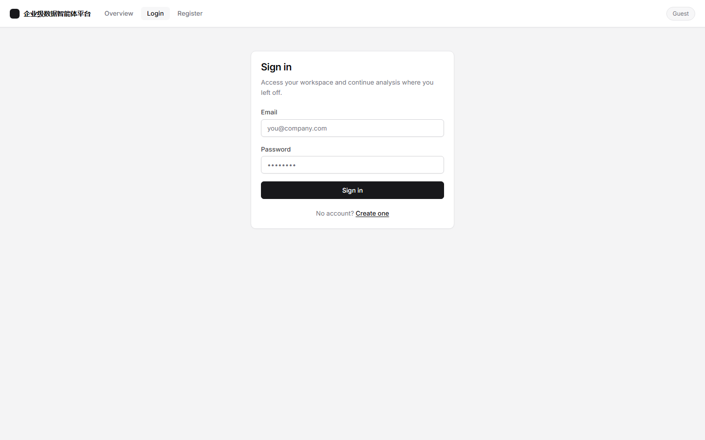
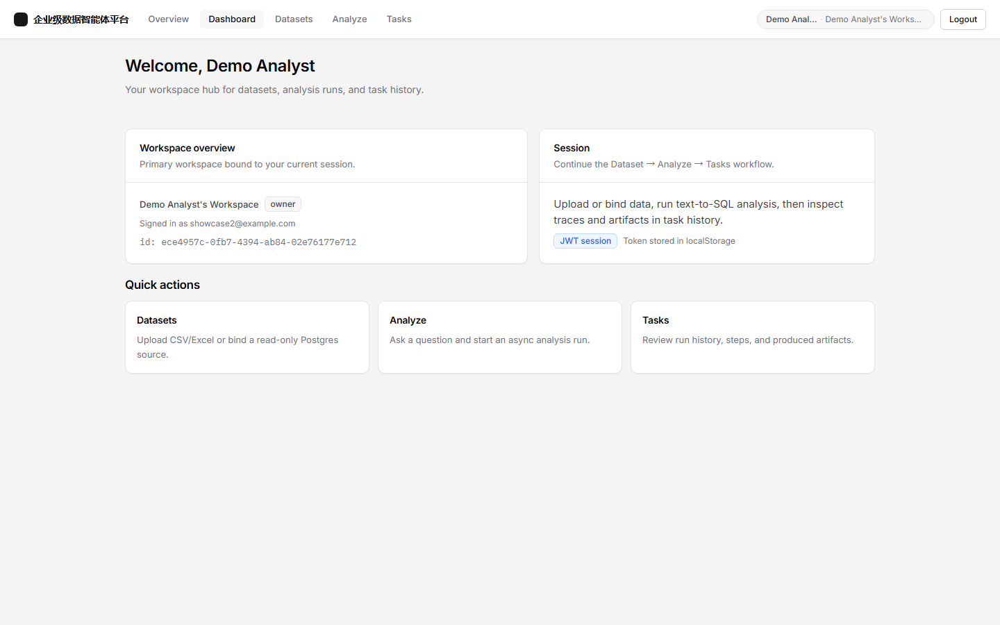
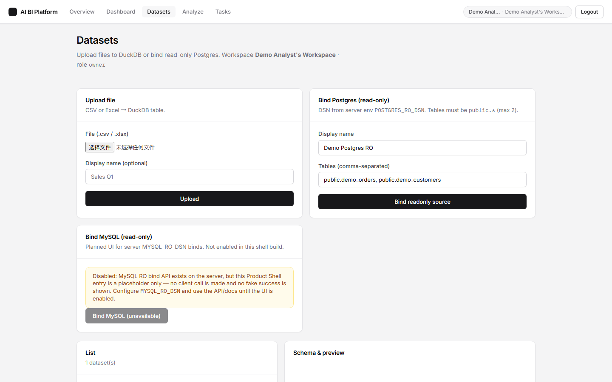
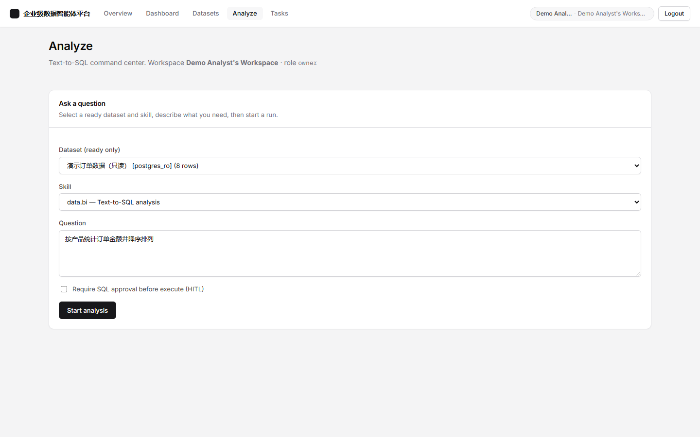
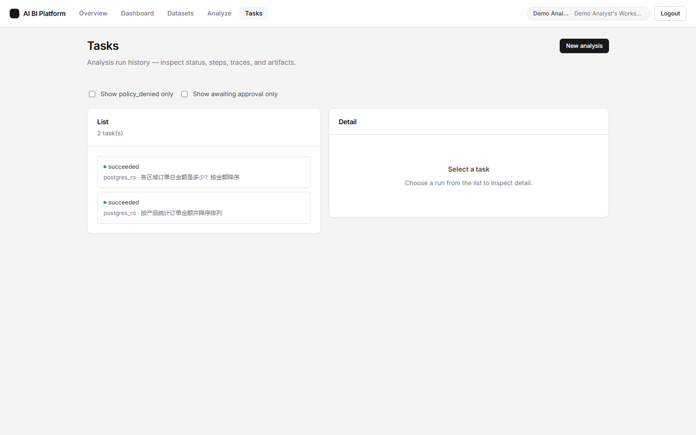
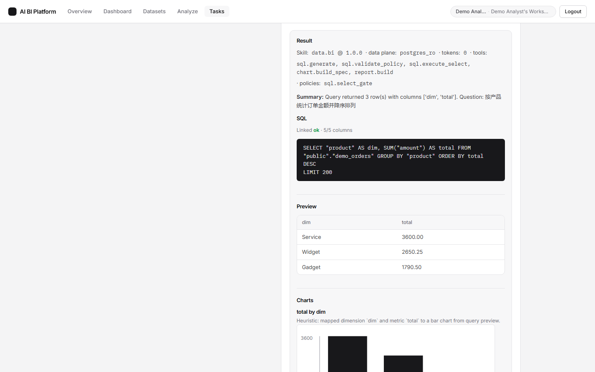
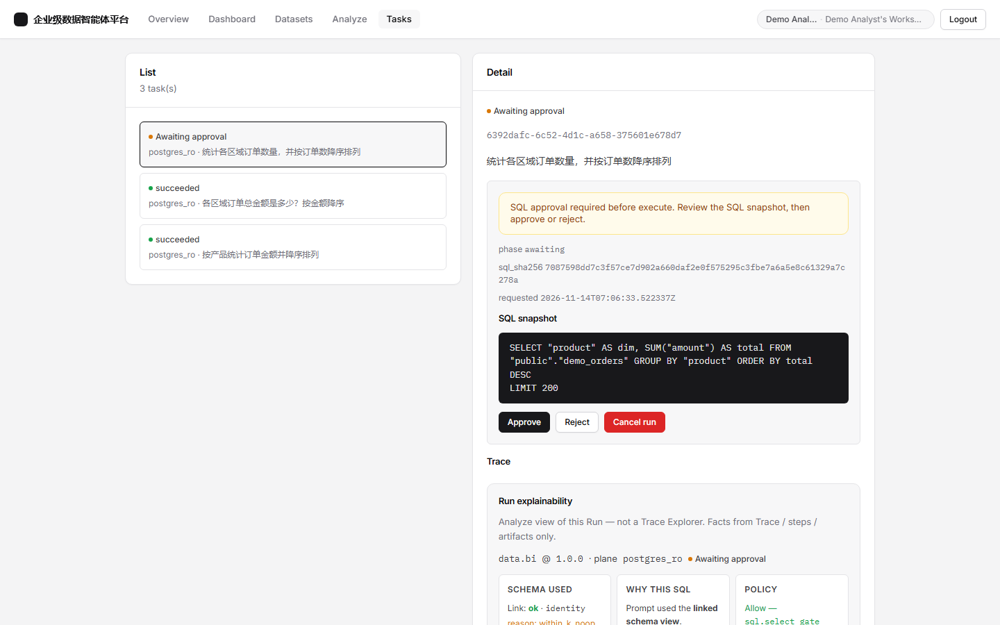
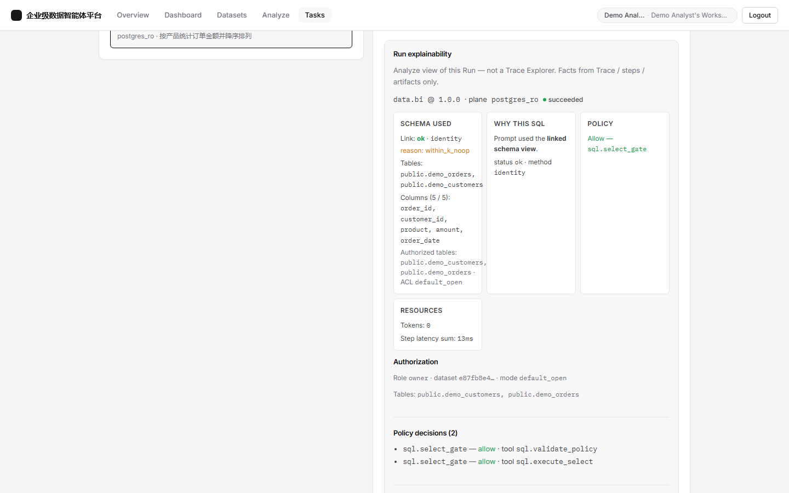
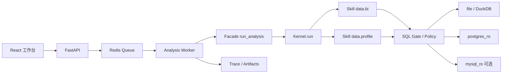
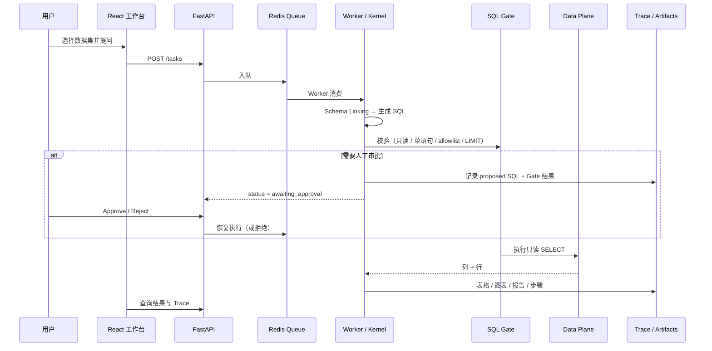

# 企业级数据智能体平台

### Enterprise Data Agent Platform

[](https://github.com/yshhas/AI-Business-Intelligence-Platform/actions/workflows/ci.yml)


> 用自然语言问数据：LangGraph 固定流水线生成 SQL，三重安全校验后只读执行；
> 高风险查询可暂停等待人工审批，最终交付表格、图表与摘要报告，并保留全链路 Trace。

---

## 项目速览

| 项目 | 说明 |
|------|------|
| 定位 | 面向企业数据分析场景的 AI Agent 平台，不是通用聊天机器人，也不是 BI 报表工具 |
| 核心链路 | 提问 → Schema Linking → SQL 生成 → 安全校验 → 人工审批（可选）→ 只读执行 → 结果交付 |
| 我的角色 | 独立设计与实现：架构、后端、Agent 流水线、评测体系、前端工作台 |
| 技术栈 | Python · FastAPI · LangGraph · PostgreSQL · Redis · DuckDB · React · TypeScript · Docker |
| 当前状态 | 本地可运行；单元测试 **737 passed**；已推送版本 CI `CI Release Gate` 通过（最新整理提交待推送后验证） |
| 适用场景 | 求职项目展示、Agent 架构评审、企业数据分析 PoC |

### 这个项目解决了什么问题

企业里"用自然语言查数据"通常有三类问题：

1. **正确性**：LLM 生成的 SQL 可能写错、越权、甚至包含写操作。
2. **治理**：缺少 Run 级的超时、取消、预算、失败分类与审计能力。
3. **可扩展**：每增加一种分析能力，就要重写一套系统。

本项目的答案是：用**固定 LangGraph 流水线**约束 Agent 行为，用**三重 SQL Gate** 保证只读与最小权限，用 **HITL 人工审批** 处理高风险查询，用 **Trace / Artifacts** 让每次分析可追溯、可交付。

---

## 效果展示

> 以下截图来自本地 Compose 环境，未配置外部 LLM：SQL 由确定性回退逻辑生成并真实执行，用于展示界面、Trace 与交付形态；配置 `LLM_API_KEY` 后即可进行真实模型问答。





| 数据集管理 | 发起分析 |
|------------|----------|
|  |  |

| 任务列表 | 结果交付（SQL / 表格 / 图表 / 报告） |
|----------|--------------------------------------|
|  |  |

| 人工审批（HITL） | 执行 Trace 与 Artifacts |
|------------------|--------------------------|
|  |  |

---

## 核心功能

1. **LangGraph 固定流水线 Text-to-SQL**  
   不使用自由 ReAct 循环，节点固定、顺序可审计：`load_context → link_schema → generate_sql → validate_sql → execute_sql → hitl_plan_done → summarize → build_charts → write_report`。

2. **三重 SQL 安全校验**  
   Skill 节点校验、Kernel Tool/Policy 包装、Data Plane 执行前再校验，三层都调用同一个确定性 SQL Gate。

3. **Human-in-the-Loop 人工审批**  
   可按任务开启 SQL 审批：Run 暂停在 `awaiting_approval`，审批通过后只执行已审批的 SQL 快照；拒绝会以 `hitl_rejected` 结束。**默认关闭**，由 `HITL_SQL_APPROVAL_ENABLED` 与任务参数共同控制。

4. **数据集 ACL 与最小权限**  
   Dataset 级 `can_read` / `can_run` 授权，权限结果投影为 SQL Gate 的表 allowlist；Viewer 只能查看 Trace，不能执行或审批。

5. **三种只读数据面**  
   CSV/Excel → DuckDB（`file`）、PostgreSQL 只读（`postgres_ro`）、可选 MySQL 只读（`mysql_ro`）；平台元数据库与分析库使用不同连接串。

6. **执行 Trace 与 Artifacts**  
   每次 Run 记录节点步骤、Schema 使用、SQL 生成依据、Policy 决策、资源消耗；产出表格、图表、报告等 Artifact，并保留 `failure_class`。

7. **Eval 回归与 Release Gate**  
   7 个评测套件（core / quality / profile / e2e / safety / llm / repair），基线回归接入发布门禁。

8. **React 工作台**  
   登录、工作台、数据集、分析、任务、审批、Trace、Artifacts 全流程界面。

---

## 系统架构

```text
React 工作台 → FastAPI → Redis Queue → Worker → Kernel → Skill → Policy → Data Plane
                                                      ↓
                                              Trace / Artifacts
```



| 层 | 职责 |
|----|------|
| Product Shell | 登录 / 工作区 / 数据集 / 任务 / SSE 进度 / 审批入口 |
| Worker | 消费队列、超时、取消、容量、软预算、失败分类 |
| Kernel | 注册与调度 Skill / Tool / Policy / Artifact |
| Skill | `data.bi`（Text-to-SQL）与 `data.profile`（确定性画像） |
| Policy | 只读 SELECT Gate + 表 allowlist |
| Data Plane | DuckDB / PostgreSQL RO / 可选 MySQL RO |
| Trace | 节点步骤、执行摘要、Artifact、`failure_class` |

### 为什么是固定流水线，而不是自由 ReAct

企业的数据分析需要"可审计、可复现、可治理"。自由 ReAct 的工具选择路径不固定，难以解释每一步为什么执行、也难以做稳定的权限与质量门禁。本项目把分析过程固化为 LangGraph 图：节点职责明确、重试与修复有上限、每一次 Gate 决策都进入 Trace。

---

## 核心业务流程



---

## LangGraph 固定工作流

`agent/graph.py` 中的图结构（节选）：

| 节点 | 作用 |
|------|------|
| `load_context` | 加载数据集、工作区、Schema 上下文 |
| `link_schema` | Schema Linking：筛选候选表 / 字段，结合工作区记忆 |
| `generate_sql` | 调用 LLM 生成 SQL |
| `validate_sql` | SQL Gate：只读、单语句、表 allowlist、自动 LIMIT |
| `execute_sql` | 通过 Data Plane 只读执行 |
| `hitl_plan_done` | 需要审批时在此暂停，保存 SQL 快照 |
| `summarize` | 生成结果摘要 |
| `build_charts` | 生成图表规格（前端 SVG 渲染） |
| `write_report` | 生成 Markdown 报告 |

失败路径统一进入 `fail` 节点，并写入 `failure_class`。

---

## Text-to-SQL 实现过程

1. **Schema Linking**：根据问题与数据集元信息筛选相关表与字段；工作区记忆可复用历史表选择。
2. **Prompt 构建**：注入表结构、字段类型、允许的表集合与输出约束。
3. **LLM 生成**：通过 OpenAI 兼容接口调用（默认 DeepSeek 配置，可替换）。
4. **SQL 提取与规范化**：从模型输出中提取 SQL，去除多余文本。
5. **校验与修复**：Gate 拒绝时进入有限次修复（默认最多 2 次），仍失败则返回 `policy_denied` 或 `skill_error`。
6. **执行与交付**：只读执行后生成表格预览、图表与报告。

---

## 三重 SQL 安全校验

| 层 | 位置 | 校验内容 |
|----|------|----------|
| 1. Skill 节点 | `agent/nodes/pipeline.py` | 单语句、SELECT / WITH、禁用写操作与 DDL、表 allowlist、自动 LIMIT |
| 2. Kernel Tool / Policy | `agent/kernel/policies.py`、`agent/kernel/tools.py` | 统一包装 Gate 结果，防止绕过 Policy |
| 3. Data Plane | `backend/app/services/duckdb_service.py`、`postgres_ro_service.py`、`mysql_ro_service.py` | 执行前再次 Gate，防止 Shell 旁路 |

Gate 规则（`agent/gates/sql_gate.py`）：

- 只允许单条语句；
- 只允许 `SELECT` / `WITH`；
- 禁止 `INSERT / UPDATE / DELETE / DROP / ALTER / CREATE / TRUNCATE / ATTACH / COPY / PRAGMA …`；
- 表名必须在 allowlist 中；
- 没有 LIMIT 时自动追加默认上限（200 行）。

---

## 人工审批（HITL）

> **默认关闭**。需要时设置 `HITL_SQL_APPROVAL_ENABLED=true`，并在创建任务时传入 `require_sql_approval=true`。

流程：

1. Agent 完成 SQL 生成与 Gate 校验后暂停，Run 状态为 `awaiting_approval`；
2. 工作台展示待审批 SQL、Gate 决策与风险信息；
3. Owner / Analyst 可以 **Approve** 或 **Reject**：
   - Approve：写入恢复请求，由 Worker 以 CAS 方式恢复执行，只执行已批准的 SQL 快照；
   - Reject：Run 以 `hitl_rejected` 结束，不执行 SQL；
4. Viewer 只读，不能审批；
5. 审批超时会按策略过期，Trace 保留完整决策记录。

设计细节：[HITL_SQL_APPROVAL_DESIGN.md](docs/design/HITL_SQL_APPROVAL_DESIGN.md)

---

## ACL、Trace 与 Artifacts

- **ACL**：数据集级授权，`can_read` / `can_run` 分离；授权结果投影为 Gate 表 allowlist。
- **Trace**：节点步骤、Schema 使用、SQL 生成依据、Policy 决策、资源与耗时。
- **Artifacts**：表格、图表、报告等交付物，结果 JSON 只保留热数据，完整内容通过 Artifact 引用读取。
- **失败分类**：`policy_denied`、`timeout`、`cancelled`、`capacity_rejected`、`budget_rejected`、`connector_error`、`hitl_rejected`、`internal_error` 等。

---

## 技术栈

| 层 | 技术 |
|----|------|
| 前端 | React 19 · TypeScript · Vite · TanStack Query · 原生 SVG 图表 |
| API | FastAPI · Pydantic v2 · SQLAlchemy 2 · Alembic · PyJWT |
| Agent | LangGraph · sqlparse · httpx（OpenAI 兼容接口） |
| 数据 | PostgreSQL 16 · DuckDB · Redis 7 · 可选 MySQL |
| 质量 | pytest · Eval Golden Suites · GitHub Actions |
| 部署 | Docker Compose · Nginx · Prometheus / Grafana（可选 profile） |

---

## 目录结构

```text
.
├── agent/          # Kernel、Skills、SQL Gate、LangGraph 流水线
├── backend/        # FastAPI API、Worker、数据面、Alembic、测试
├── frontend/       # React 工作台
├── evals/          # 7 个评测套件与基线
├── docker/         # Compose、Nginx、Dockerfile、只读演示库
├── docs/           # 架构 / 设计 / 运维 / 测试 / 历史归档
├── compose.yaml    # 根目录一键启动入口
└── README.md
```

更完整的目录说明：[DIRECTORY_STRUCTURE.md](docs/architecture/DIRECTORY_STRUCTURE.md)

---

## 快速开始

### 前置条件

- Docker + Docker Compose ≥ 2.20
- Python 3.12+（本地 venv 方式）
- Node.js 20+（本地前端开发）

### 方式一：Docker Compose（推荐）

```powershell
copy .env.example .env
# 如需真实问答：在 .env 中填写 LLM_API_KEY
docker compose up -d --build
```

启动后：

| 服务 | 地址 |
|------|------|
| Web 工作台 | http://127.0.0.1:8080 |
| API 健康检查 | http://127.0.0.1:8000/health/ready |
| Worker 健康检查 | http://127.0.0.1:8001/health/live |

生成演示数据并跑通一次分析：

```powershell
python backend/scripts/demo_bootstrap.py --ask "各区域订单总金额是多少？按金额降序"
```

> 该脚本只通过真实 HTTP API 操作，不绕过鉴权、Policy、SQL Gate 或 HITL。演示数据来自 `docker/postgres_ro_init` 中的合成订单表。

### 方式二：本地 venv + 前端

```powershell
cd backend
python -m venv .venv
.\.venv\Scripts\activate
pip install -r requirements.txt
alembic upgrade head
uvicorn app.main:app --reload --host 127.0.0.1 --port 8000
```

另开终端启动 Worker：

```powershell
cd backend
.\.venv\Scripts\activate
python -m app.workers.analysis_worker
```

前端：

```powershell
cd frontend
npm install
npm run dev
```

### 无 LLM Key 的界面演示

`ANALYSIS_RUNTIME=mock` 可在不调用外部模型的情况下跑通任务生命周期与 UI（结果为占位数据）。开启方式：

```powershell
$env:ANALYSIS_RUNTIME="mock"
docker compose up -d --build
```

真实分析请保持 `ANALYSIS_RUNTIME=agent` 并配置 `LLM_API_KEY`。

---

## 测试与质量

```powershell
# Agent 单元测试（纯 mock，不调用外部 LLM）
python -m pytest agent/tests -q

# Backend 单元测试（纯 mock，无需数据库 / Redis）
python -m pytest backend/tests -q

# Compose 配置校验
docker compose config --quiet
```

本机实测（2026-11-14）：

| 测试 | 结果 |
|------|------|
| `agent/tests` | **569 passed** |
| `backend/tests` | **168 passed** |
| 合计 | **737 passed / 0 failed** |

评测：

```powershell
cd backend
.\.venv\Scripts\python.exe scripts\smoke_eval_golden.py --suite core
```

| 套件 | 基线结果 |
|------|----------|
| core | 8/8（含 2 skipped） |
| quality | 6/6 |

CI：[`.github/workflows/ci.yml`](.github/workflows/ci.yml) 执行前端 lint/build、后端 smoke 与 Release Gate。

已知限制与取舍：[TESTING_KNOWN_ISSUES.md](docs/testing/TESTING_KNOWN_ISSUES.md)

---

## 安全设计

- **只读隔离**：平台元数据库 `DATABASE_URL` 与企业只读库 `POSTGRES_RO_DSN` / `MYSQL_RO_DSN` 分离。
- **三重 Gate**：Skill、Kernel、Data Plane 三层校验，同一条 SQL 不会绕过任何一层。
- **最小权限**：Dataset ACL 投影为表 allowlist；Viewer 只读。
- **人工审批**：高风险 SQL 可暂停，审批快照与 SHA256 校验绑定，防止审批后替换 SQL。
- **身份与会话**：短效 Access Token + Refresh Token、限流、可选 OIDC。
- **密钥管理**：`.env` 不入库，仓库只保留 `.env.example`；生产环境要求强 `JWT_SECRET`。
- **演示数据**：仓库内 CSV 与 Compose 初始化数据均为合成数据。

---

## 文档导航

| 文档 | 内容 |
|------|------|
| [docs/README.md](docs/README.md) | 按角色分流的完整文档导航 |
| [PLATFORM_CHARTER.md](docs/architecture/PLATFORM_CHARTER.md) | 平台定位与边界 |
| [PLATFORM_CONTRACTS.md](docs/architecture/PLATFORM_CONTRACTS.md) | Kernel / Skill / Policy / Run 合同 |
| [HITL_SQL_APPROVAL_DESIGN.md](docs/design/HITL_SQL_APPROVAL_DESIGN.md) | 人工审批设计 |
| [OPS_RUNBOOK.md](docs/ops/OPS_RUNBOOK.md) | 部署、探针与排障 |
| [OPS_CONFIG_MATRIX.md](docs/ops/OPS_CONFIG_MATRIX.md) | 环境变量矩阵 |
| [API_ERROR_CODES.md](docs/ops/API_ERROR_CODES.md) | 错误码与失败分类 |
| [FINAL_RELEASE.md](docs/FINAL_RELEASE.md) | v1.0 发布说明 |

---

## 已知限制

- HITL 默认关闭，需要显式配置；未开启时任务直接执行已通过 Gate 的 SQL。
- 取消与超时是协作式的：新节点会停止，但已在途的 LLM HTTP 或 SQL 查询可能仍会完成，成功写入会被围栏阻止。
- SQL Gate 允许只读的 `EXPLAIN`，已在测试文档中记录。
- 当前只提供本地部署，没有在线 Demo。
- 非目标：RAG 问答主路径、自由 ReAct、通用多智能体平台、Connector Framework。
- `mock` 模式仅用于界面与生命周期演示，不代表真实问答效果。

---

## License

MIT — 见 [LICENSE](LICENSE)。
