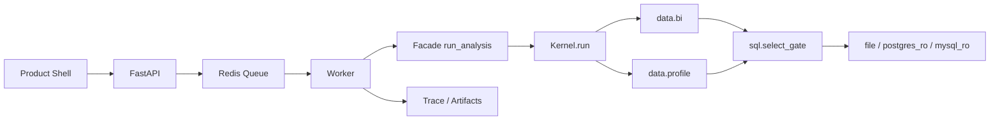

# Enterprise Data Agent Platform

**Release v1.0 — Feature Freeze**（2026-07-22）· Wave 4 未启动 · 无新需求不改代码

个人简历级 **Enterprise Data Agent Platform**（企业数据 Agent 平台）。

> 一个可治理的 Enterprise Data Agent Platform，而不是一个 BI 应用。

**交付文档：** [FINAL_RELEASE](docs/FINAL_RELEASE.md) · [RESUME_HIGHLIGHTS](docs/RESUME_HIGHLIGHTS.md) · [INTERVIEW_GUIDE](docs/INTERVIEW_GUIDE.md) · [DIRECTORY_STRUCTURE](docs/DIRECTORY_STRUCTURE.md) · [Stabilization Review](docs/FINAL_STABILIZATION_REVIEW.md)

| Layer | Meaning |
|-------|---------|
| **Platform / Kernel** | Agent Runtime：`run`、Skill/Tool/Policy/Artifact 注册与调度 |
| **Skills** | **`data.bi`**（Text-to-SQL → 表/图/报告）· **`data.profile`**（确定性数据集画像） |
| **Run Governance** | Worker：timeout / cancel / `failure_class` / capacity / budget |
| **Data Plane** | Policy 之后：`file`→DuckDB · `postgres_ro` · 可选 `mysql_ro` |
| **Product shell** | Workspace / Dataset / Task / React 工作台 · 可选 OIDC · MCP 只读旁路 |

> ChatBI 不再是平台定义，而是第一个 Data Skill。

## 架构脊柱（锁定）

```text
Product Shell → Worker → Kernel → Skill → Policy → Data Plane → Trace / Artifacts
```



## 演进状态

| 阶段 | 状态 | 说明 |
|------|------|------|
| Era 1–2（M0–M6） | ✅ Frozen | Kernel · Plane · Trace · ACL · Artifacts |
| Wave 0–1 Trust | ✅ Done | Eval · JWT refresh · Rate limit · 配置硬化 |
| Wave 2 Operate | ✅ Done | Linking v2 · Metrics · Nginx · Repair |
| Wave 3 Platform Proof | ✅ Done | 第二 Skill · Memory · OIDC · MCP · Idempotency · Guardrails |
| **Stabilization** | ✅ Done | 安全加固 · 文档对齐 · 质量门禁 |
| **Release v1.0** | ✅ **Feature Freeze** | [FINAL_RELEASE.md](docs/FINAL_RELEASE.md) |
| Wave 4 Enterprise Deploy | ⏳ Pending | 单云 IaC 等 — **未启动 · 需明确授权** |

**SSOT 路线图：** [project_upgrade_plan.md](project_upgrade_plan.md)  
**稳定化报告：** [docs/FINAL_STABILIZATION_REVIEW.md](docs/FINAL_STABILIZATION_REVIEW.md)

**禁区仍在：** RAG 主路径、ReAct 自由环、Connector Framework、Celery 无证据、Code Agent、多云齐上。

## 仓库结构

```text
frontend/   React + TypeScript 工作台
backend/    FastAPI API + Worker + Data Plane
agent/      Kernel + Skills (data.bi / data.profile)
evals/      Golden suites + Eval runner
docker/     Compose（Postgres + Redis + RO Demo + optional web）
docs/       Charter / Ops / Wave docs / Review
```

## 快速开始

### 1. Compose（API + Worker + 依赖）

```powershell
copy .env.example .env
# 演示请设置 ANALYSIS_RUNTIME=agent
docker compose -f docker/docker-compose.yml --env-file .env up -d --build
# http://127.0.0.1:8000/health/ready
```

详情：[docker/README.md](docker/README.md) · [docs/OPS_RUNBOOK.md](docs/OPS_RUNBOOK.md)

### 2. 本机 venv

```powershell
cd backend
python -m venv .venv
.\.venv\Scripts\activate
pip install -r requirements.txt
alembic upgrade head
uvicorn app.main:app --reload --host 127.0.0.1 --port 8000
# 另开终端：
python -m app.workers.analysis_worker
```

Release gate：`python scripts/smoke_release_gate.py`

### 3. 前端

```powershell
cd frontend
npm install
npm run dev
```

### 4. Demo 要点

1. 上传 CSV → Analyze（`data.bi` / file 平面）  
2. API：`skill_id=data.profile` 证明第二 Skill  
3. Datasets → Bind Postgres RO（可选 MySQL RO）  
4. 非法 SQL → `policy_denied`；Cancel / timeout → `failure_class`  

## Wave 3 文档索引

| Doc | Topic |
|-----|-------|
| [SKILL_DATA_PROFILE_CHARTER.md](docs/SKILL_DATA_PROFILE_CHARTER.md) | 第二 Skill 合同 |
| [DATA_PLANE.md](docs/DATA_PLANE.md) | Plane / MySQL RO |
| [WORKSPACE_MEMORY.md](docs/WORKSPACE_MEMORY.md) | Linking 记忆 |
| [OIDC.md](docs/OIDC.md) | 可选 SSO |
| [MCP.md](docs/MCP.md) | 只读工具旁路 |
| [API_ERROR_CODES.md](docs/API_ERROR_CODES.md) | HTTP / failure_class |
| [OPS_CONFIG_MATRIX.md](docs/OPS_CONFIG_MATRIX.md) | 环境变量 |

## 配置要点

- `ANALYSIS_RUNTIME=agent`（演示/企业路径；代码默认 `mock` 仅本地骨架）  
- **production / staging** 启动时拒绝 `ANALYSIS_RUNTIME=mock`（P1.6）  
- `POSTGRES_RO_DSN` / 可选 `MYSQL_RO_DSN` 与 `DATABASE_URL` **分离**  
- `SKILL_DATA_BI_*` / `SKILL_DATA_PROFILE_*` Lifecycle  
- OIDC 默认关闭；生产需强 `JWT_SECRET`

## License

MIT — see [LICENSE](LICENSE).

## Release artifacts

| Doc | Purpose |
|-----|---------|
| [RELEASE_NOTES.md](RELEASE_NOTES.md) | GitHub Release v1.0 notes |
| [CHANGELOG.md](CHANGELOG.md) | Keep a Changelog |
| [RELEASE.md](RELEASE.md) | Root freeze marker |
| [docs/FINAL_RELEASE.md](docs/FINAL_RELEASE.md) | Canonical release narrative |
