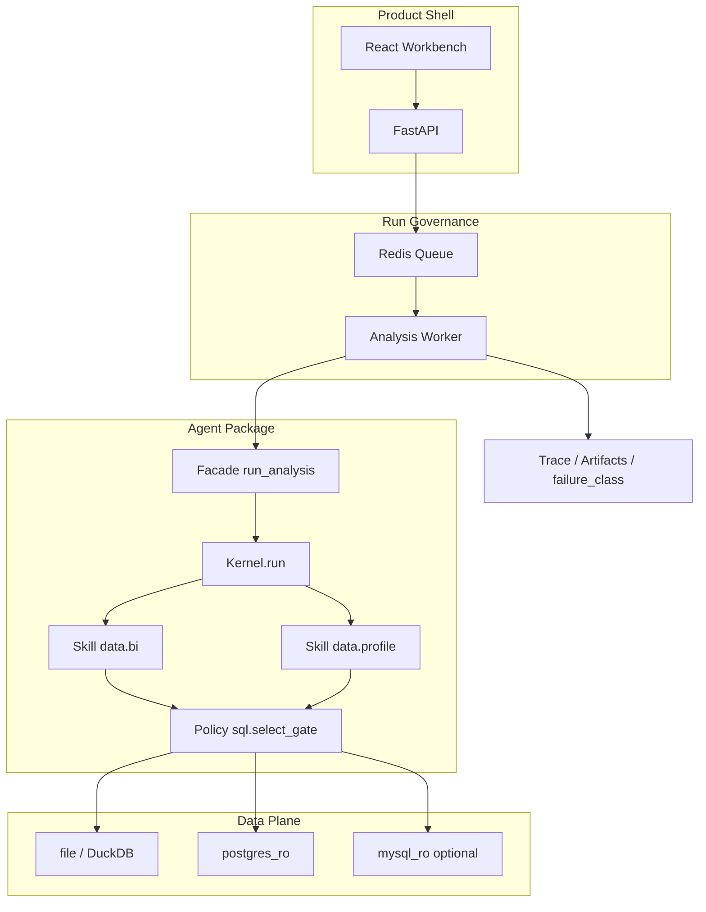

# FINAL RELEASE — Enterprise Data Agent Platform v1.0

**Release:** v1.0 · **Feature Freeze** · 2026-07-22  
**Status:** Stabilization complete · Wave 4 **not started** · no further feature work without explicit request

> 一个可治理的 Enterprise Data Agent Platform，而不是一个 BI 应用或聊天机器人。

---

## 1. 项目简介

本项目是一套 **Governed Enterprise Data Agent Platform**：产品壳发起分析 Run，Worker 治理生命周期，Kernel 调度 Skill，Policy 强制 SQL 门禁，Data Plane 只读执行，Trace/Artifacts 作为执行真相。

第一 Skill `data.bi` 覆盖 Text-to-SQL → 表 / 图 / 报告；第二 Skill `data.profile` 证明平台可在同一合同下扩展，而不是做成第二个单体应用。

**适用叙事：** 简历 / 面试 / 架构评审 / 企业试点演示（staging）。  
**非目标：** RAG 问答主路径、ReAct 自由环、Multi-Agent OS、Connector Framework、无证据上 Celery。

---

## 2. 核心架构

```text
Product Shell → Worker → Kernel → Skill → Policy → Data Plane → Trace / Artifacts
```



| Layer | Responsibility |
|-------|----------------|
| Product Shell | Workspace / Dataset / Task / JWT(+可选 OIDC) / SSE |
| Worker | Enqueue claim · timeout · cancel · capacity · budget |
| Kernel | Skill/Tool/Policy registry · `run(skill_id)` |
| Skill | Domain pack（固定图或确定性流水线，非自由 ReAct） |
| Policy | SELECT-only Gate + allowlist |
| Data Plane | `file` · `postgres_ro` · optional `mysql_ro` |
| Trace | Steps · Execution Trace · Artifacts · `failure_class` |

**SSOT：** [`project_upgrade_plan.md`](archive/roadmap/project_upgrade_plan.md) · Charter [`docs/architecture/PLATFORM_CHARTER.md`](architecture/PLATFORM_CHARTER.md)

---

## 3. 已实现能力

| Domain | Capabilities |
|--------|----------------|
| Skills | `data.bi` · `data.profile` · Lifecycle enable/version |
| Governance | timeout · cancel · capacity · soft token budget · Idempotency-Key |
| Security | short JWT + refresh · rate limit · prod JWT harden · ACL + table projection · OIDC MVP · output guardrails |
| Data | CSV/XLSX→DuckDB · Postgres RO · optional MySQL RO |
| Quality | Eval core/quality/profile · Prompt change gate · Release gate |
| Ops | Compose · `/metrics` · Worker health · Nginx web profile · structured logs |
| Extensibility proof | Workspace memory · MCP read-only HTTP · second Skill same contracts |

**Won't Do（冻结红线）：** RAG 主路径 · ReAct 替换固定 Skill · LangChain 重写主路径 · WebSocket 聊天化 · Celery 无证据 · Code Agent · Connector Framework。

---

## 4. 技术栈

| Layer | Stack |
|-------|--------|
| Frontend | React · TypeScript · Vite · TanStack Query · oxlint |
| API | FastAPI · Pydantic v2 · SQLAlchemy 2 · Alembic · PyJWT · Redis |
| Agent | LangGraph（`data.bi` 固定图）· sqlparse Gate · httpx LLM |
| Data | DuckDB · Postgres · optional PyMySQL |
| Eval / CI | PyYAML suites · GitHub Actions · smoke_release_gate |
| Observability | prometheus_client · request_id · run_id / failure_class logs |

---

## 5. 系统亮点

1. **脊柱不可推翻** — 所有能力挂在同一 Run 合同上，避免「Agent 玩具」发散。  
2. **三重 SQL Gate** — Skill 校验 · Tool 包装 · Plane 再 Gate。  
3. **第二 Skill 证明可扩展** — 同一 Kernel/Lifecycle/Worker，无特殊路径。  
4. **诚实失败** — `failure_class` + Trace，超时/取消/策略拒绝可审计。  
5. **可证伪质量** — Eval 基线回归进入 Release Gate。  
6. **企业最小权限** — Dataset ACL 投影进 Gate allowlist。  

---

## 6. 与普通 AI Demo 的区别

| 普通 AI Demo | 本平台 v1.0 |
|--------------|-------------|
| Chat 框 + 一次 LLM 调用 | Governed **Run** + Worker 生命周期 |
| 自由 Tool / ReAct | 固定 Skill 图 + Policy 强制 |
| 信任模型输出 | Gate + allowlist + Trace 审计 |
| 单文件/SQLite 玩具库 | 元数据库 ≠ 只读数据面 DSN |
| 「接了 LangChain」即企业级 | 边界、Eval、容量、预算、ACL 可讲述 |
| 无限扩展叙事 | 明确 Won't Do + Feature Freeze |

---

## 7. 后续规划（仅列出，不实现）

| Item | Notes |
|------|--------|
| Wave 4 — 单云 IaC | AWS **或** 腾讯云二选一 |
| Refresh token 吊销 | `jti` 落库 / 轮换 |
| 真实 IdP + MySQL soak | 生产联调 |
| Cooperative timeout cancel | 避免孤儿 step 写入 |
| `result_json` 热/冷归档 | 表膨胀治理 |
| Memory TTL / 容量帽 | 防无限增长 |
| Frontend skill picker | UX；API 已支持 `skill_id` |
| Celery / 增量 steps | **仅 Metrics 证明瓶颈后** |

详见 [`FINAL_STABILIZATION_REVIEW.md`](archive/reviews/FINAL_STABILIZATION_REVIEW.md) §6。

---

## 8. 交付物索引

| Doc | Purpose |
|-----|---------|
| [FINAL_RELEASE.md](FINAL_RELEASE.md) | 本文件 |
| [RESUME_HIGHLIGHTS.md](archive/interview/RESUME_HIGHLIGHTS.md) | 简历亮点 |
| [INTERVIEW_GUIDE.md](archive/interview/INTERVIEW_GUIDE.md) | 面试指南 |
| [FINAL_STABILIZATION_REVIEW.md](archive/reviews/FINAL_STABILIZATION_REVIEW.md) | 稳定化审查 |
| [DIRECTORY_STRUCTURE.md](architecture/DIRECTORY_STRUCTURE.md) | 目录结构 |
| [../README.md](../README.md) | 快速开始 |
| [../project_upgrade_plan.md](archive/roadmap/project_upgrade_plan.md) | 路线图 SSOT |
| [API_ERROR_CODES.md](ops/API_ERROR_CODES.md) | API 契约 |
| [OPS_RUNBOOK.md](ops/OPS_RUNBOOK.md) | 部署运维 |

---

## 9. Release 标记

```text
Release v1.0 — Feature Freeze
Waves 0–3 + Stabilization: DONE
Wave 4: NOT STARTED
Code changes: require explicit new requirements only
```

**App version string:** `1.0.0`（FastAPI `app.version`）  
**Root marker:** [`RELEASE.md`](../RELEASE.md)  
**Quality bar:** `smoke_release_gate` + frontend `lint`/`build` must remain green before any future thaw.
