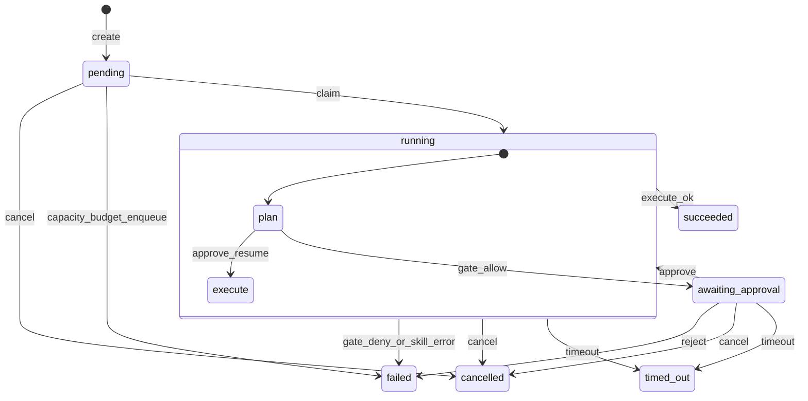

# HITL Implementation Plan

**Document type:** Single SSOT — Implementation Plan (Design-only)  
**Status:** A1–A5 **accepted** · Plan Review **PASS WITH CONDITIONS** · **Implementation Sprint not authorized**  
**Date:** 2026-07-22  
**Baseline:** Enterprise AI Data Platform **v1.1.0** (`6d80ef3`)  
**Supersedes for planning detail:** `docs/HITL_IMPLEMENTATION_DESIGN_REVIEW.md` (pointer only) · builds on `docs/HITL_SQL_APPROVAL_DESIGN.md`  
**Plan Review:** `docs/HITL_IMPLEMENTATION_PLAN_REVIEW.md` (locks R1–R8 integrated in Addendum below)

**Process lock:**

| Rule | Status |
|------|--------|
| Design-only | **Yes** |
| Coding | **Forbidden** until separate Sprint authorization |
| Commit / push | **Forbidden** in this phase |
| Tag `v2.0.0` | **Forbidden** |
| Spine direction | Unchanged |

**Spine:**

```text
Product Shell → Worker → Kernel → Skill → Policy → Data Plane → Trace / Artifacts
```

**Version posture (A4):** Prefer ship as **v1.2.x MVP** if this plan’s scope is held; escalate packaging to **v2.0.0** only if §4.4 triggers fire. No tag is cut by this document.

---

# A1 — Complete business flow & state machine

## A1.1 Goal

Opt-in human pause **after Policy Gate allow** and **before any Data Plane execute**, on the **same** Run (`task_id`).

- Policy answers: *May this SQL run?*  
- HITL answers: *Does a human want it to run now?*

## A1.2 Happy path (Approve)

```text
1. Shell: POST /tasks
     { dataset_id, question, skill_id: "data.bi", require_sql_approval: true }
     Preconditions: HITL_SQL_APPROVAL_ENABLED=true; skill=data.bi
     → status=pending; require_sql_approval persisted

2. Worker claim → status=running · phase=plan
     Skill: link → generate_sql → Policy Gate
     · Gate DENY → status=failed · failure_class=policy_denied  (STOP; no wait)
     · Gate ALLOW → persist SQL snapshot + gate outcome into result_json / Trace

3. Worker → status=awaiting_approval
     write fence CLOSED · no execute_select · no plane I/O
     platform.hitl = { required: true, phase: "awaiting", sql_sha256, … }

4. Shell: analyst reviews SQL + Gate summary → POST .../approve
     Auth: creator or workspace owner
     → Worker resume (same task_id)

5. Worker → status=running · phase=execute
     Verify SQL snapshot match (mismatch → failed, fail-closed)
     Skill: execute_sql (+ summarize / charts / report)
     Tool + Plane re-apply Gate (defense in depth)
     → succeeded | failed (existing failure classes)
```

## A1.3 Reject

```text
awaiting_approval
  → POST .../reject  { reason?: string }
  → status=failed
  → failure_class=hitl_rejected
  → no Data Plane execute
  → Trace records decision + optional reason
```

## A1.4 Cancel

| From | Behavior |
|------|----------|
| `pending` | Immediate `cancelled` (existing) |
| `running` (plan or execute) | `cancel_requested` → cooperative `cancelled` (P1.1) |
| `awaiting_approval` | → `cancelled` + `failure_class=cancelled`; fence already closed; **never** execute |

## A1.5 Timeout

| From | Behavior |
|------|----------|
| `running` | Existing wall-clock → `timed_out` |
| `awaiting_approval` | Wall-clock **continues** during wait → `timed_out` + `failure_class=timeout`; **never** execute |

Stale-running reclaim (**`runtime_reclaimed`**) **does not** apply to `awaiting_approval`; waiting Runs end by human action or wall-clock timeout.

## A1.6 State machine

**Status strings:**

| Status | Meaning |
|--------|---------|
| `pending` | Queued |
| `running` | Plan or execute (see `platform.hitl.phase`) |
| `awaiting_approval` | **New** — human wait |
| `succeeded` / `failed` / `cancelled` / `timed_out` | Terminals |

```text
ACTIVE_STATUSES   = { pending, running, awaiting_approval }
TERMINAL_STATUSES = { succeeded, failed, cancelled, timed_out }
```



**Idempotency:** Second `approve`/`reject` when not `awaiting_approval` → **409**.

**Capacity:** `awaiting_approval` **counts** as in-flight.

**Skills:** MVP = **`data.bi` only**. `data.profile` + flag → **ignore flag** (no pause).

## A1.7 User interaction (Shell)

1. Create: checkbox **Require SQL approval** (only if kill-switch on + `data.bi`).  
2. While `running` / plan: existing progress UX.  
3. On `awaiting_approval`: banner, SQL, Gate summary, **Approve** / **Reject** / **Cancel**.  
4. Viewers: read-only Trace; no approve/reject.  
5. SSE/poll: treat wait as active; copy = “waiting for approval”, not “model thinking”.

---

# A2 — Spine impact analysis

| Layer | Change? | What changes | What must NOT change |
|-------|---------|--------------|----------------------|
| **Product Shell** | **Yes** | Create toggle; waiting UX; approve/reject client; status labels | No direct Agent/Plane calls |
| **Worker** | **Yes (primary)** | Two-phase run; enter/leave `awaiting_approval`; fence; resume execute; skip stale reclaim on wait | Remains **sole** Run governor |
| **Kernel** | **Light** | Pass plan/execute mode / disable execute binding in plan | Registry/lifecycle contracts |
| **Skill (`data.bi`)** | **Yes** | Stop after Gate in plan; execute only in execute phase; honor SQL snapshot | Never write terminal Run status |
| **Policy** | **No** | — | Gate algorithms; deny → terminal; **no human override of deny** |
| **Data Plane** | **No** (timing only) | First `run_select` only after approve | RO contracts; plane-side Gate |
| **Trace / Artifacts** | **Yes** | `platform.hitl`; `hitl_rejected`; plan-phase SQL visibility | Trace remains execution truth |

**Spine direction:** unchanged.  
**Spine vocabulary:** +1 active status (`awaiting_approval`).

### A2.1 Concrete surface area

| Kind | MVP |
|------|-----|
| New status | `awaiting_approval` (`String(20)` OK; no DB ENUM required) |
| Migration | Thin: `require_sql_approval boolean not null default false` (+ optional actor/timestamp columns) |
| API | Create field + `POST .../approve` + `POST .../reject` |
| Config | `HITL_SQL_APPROVAL_ENABLED` kill-switch |
| FE | Analyze/Tasks + api client + labels |
| Smokes | HITL suite in Release Gate |

---

# A3 — Scope boundaries & Non-goals

## A3.1 In scope (this plan / future HITL Sprint)

1. Opt-in `require_sql_approval` (default `false`)  
2. Global kill-switch  
3. Plan phase without Data Plane  
4. Status `awaiting_approval`  
5. Approve → Worker execute phase  
6. Reject → `failed` / `hitl_rejected`  
7. Cancel / Timeout semantics per A1  
8. SQL snapshot integrity (mismatch fail-closed)  
9. Shell UX for wait/approve/reject  
10. Smokes + Gate wiring; Eval remains green with flag off  

## A3.2 Non-goals (explicitly **out** of this Sprint)

| Non-goal | Why |
|----------|-----|
| Coding/commit/push in Design phase | Process lock |
| Mandatory workspace/org HITL policy | v2 trigger territory |
| Multi-approver / SoD / Slack-email | Workflow platform |
| Approve-with-SQL-edit | Re-plan/trust complexity |
| HITL for `data.profile` / non-SQL | Out of problem |
| Softening or replacing Policy Gate | Spine invariant |
| Semantic Layer | Separate track |
| Multi-Agent / Critic loops | Separate track; critic ≠ human HITL |
| Wave 4 IaC / Celery / queue rewrite | Out of scope |
| Cookie / P1.9 mega-refactor | Orthogonal |
| Pause wall-clock during wait | Deferred alternative |
| Full compliance export packs | Trace-only in MVP |
| Creating `v2.0.0` tag | Forbidden |

## A3.3 Duty split (stable)

| Duty | Owner |
|------|-------|
| Status + write fence + resume | **Worker** |
| SQL allow/deny | **Policy** |
| Human now/later | **Shell → API → Worker** |
| Plan/execute skill work | **Skill** under Worker |
| Select I/O | **Data Plane** only in execute |
| What happened | **Trace / Artifacts** |

## A3.4 Relation to later majors

- **Semantic:** May change proposed SQL content; does not replace HITL pause contract — **do not bundle**.  
- **Multi-Agent:** Machine critic (if ever) runs **before** Gate; human HITL stays **after** Gate allow — **do not implement here**.

---

# A4 — Risks, compatibility, rollback, version advice

## A4.1 Risks

| Risk | Level | Mitigation |
|------|-------|------------|
| Worker complexity (two-phase) | High | Explicit phase in `platform.hitl`; single task_id; checklist + smokes |
| FE treats wait as stuck | Med | Labels + SSE copy + filter support |
| In-flight capacity pressure | Med | Document; waiting counts; ops may raise cap later |
| Timeout during long human review | Med | Document; optional later `hitl_approval_timeout_seconds` |
| SQL regenerated ≠ snapshot | Med | Fail-closed |
| Gate/Eval breakage | Med | Default off; Eval omits flag; Gate red blocks merge |

## A4.2 Compatibility

| Client / path | Expectation |
|---------------|-------------|
| Omit `require_sql_approval` | Identical to **v1.1.0** |
| `HITL_SQL_APPROVAL_ENABLED=false` | Flag forced off; approve/reject disabled |
| Old FE without wait UI | May show raw status string until FE ships in same Sprint |
| API additive | Old clients never call approve/reject |

**Compatibility bar:** kill-switch off ⇒ golden paths and Eval match v1.1 behavior.

## A4.3 Rollback

1. **Immediate:** `HITL_SQL_APPROVAL_ENABLED=false`.  
2. **Parked Runs:** `cancel` or wait for `timed_out` (no plane side effects if fence held).  
3. **Code:** Revert Sprint commit(s) on `main` (no force-push; no history rewrite of `v1.1.0`).  
4. **Migration:** Column default `false` is safe to leave; down-migration only if policy requires.

## A4.4 Version recommendation

| Choice | When |
|--------|------|
| **v1.2.x MVP (recommended)** | Scope = A3.1 only; opt-in; kill-switch; no mandatory/multi-approver/edit; not bundled with Semantic/Multi-Agent/IaC; Gate/Eval PASS; narrative = optional SQL pause |
| **Hold for v2.0.0 packaging** | Mandatory HITL; multi-party SoD; approve-with-edit primary; bundled Semantic/Multi-Agent; Worker/queue substrate rewrite; headline “HITL Enterprise Platform” |

**Do not pre-create `v2.0.0`.** After Implementation Audit, operator picks tag line.

---

# A5 — Implementation plan (authorized only after Sprint kickoff)

> Everything in A5 is a **future build blueprint**. Execution requires a separate explicit authorization.

## A5.1 Database migration

| Item | Spec |
|------|------|
| Table | `analysis_tasks` |
| Required column | `require_sql_approval BOOLEAN NOT NULL DEFAULT FALSE` |
| Optional columns | `approval_requested_at TIMESTAMPTZ NULL`; `approved_by UUID NULL`; `rejected_by UUID NULL` |
| Status column | Keep `VARCHAR(20)`; store `awaiting_approval` as literal |
| Alembic | New revision after `0014_sprint2_refresh_memory` (name TBD at impl) |
| Backfill | Default false for all existing rows |

## A5.2 API / OpenAPI changes

| Method | Path | Body / notes |
|--------|------|----------------|
| POST | `/api/v1/workspaces/{workspace_id}/tasks` | + `require_sql_approval?: boolean` (default false). If kill-switch off → treat as false. If skill≠`data.bi` → ignore |
| POST | `.../tasks/{task_id}/approve` | Empty or `{}`; only `awaiting_approval`; creator/owner; signals Worker resume |
| POST | `.../tasks/{task_id}/reject` | `{ "reason": "string?" }`; → `failed`/`hitl_rejected` |
| POST | `.../tasks/{task_id}/cancel` | Extend to allow from `awaiting_approval` |
| GET | task / execution / events | Return new status + `platform.hitl` |

**Errors:** 409 if wrong status; 403 if not creator/owner; 404 if disabled/not found.

**OpenAPI:** Regenerate/update schema descriptions for Task create/out and new operations when Sprint runs.

**Permissions:** Reuse cancel authority **or** add `RUN_APPROVE` / `RUN_REJECT` (impl pick; must enforce creator/owner in MVP).

## A5.3 Worker lifecycle

1. Claim `pending` → `running` (phase=`plan`) when `require_sql_approval` and kill-switch on.  
2. Invoke Skill in **plan mode** (`execute_select` not callable / not bound).  
3. On Gate allow: persist snapshot (`sql` text + `sql_sha256`) → CAS to `awaiting_approval` → close fence → return (Worker free for other tasks).  
4. On Approve: enqueue resume job **or** dedicated resume path → CAS `awaiting_approval`→`running` (phase=`execute`) → bind execute → verify snapshot → run remainder → seal Trace/Artifacts/slim as today.  
5. On Reject/Cancel from wait: API CAS terminals (R3); never open plane.  
6. Wait timeout: Worker-loop **`expire_awaiting_approval` sweeper** (R1); exclude wait from stale reclaim; in-flight = `running` ∪ `awaiting_approval` (R5).  
7. P1.1 cancel/timeout polling remains authoritative during plan/execute `running`.  
8. Approve→execute resume = **H2** (R6/R8).

## A5.4 Frontend interaction

| Surface | Work |
|---------|------|
| Create Analyze form | Checkbox when kill-switch exposed (config endpoint or boot flag) + skill=`data.bi` |
| Task detail / Analyze result | Banner for `awaiting_approval`; SQL + Gate; Approve / Reject / Cancel buttons |
| Tasks list | Status chip + filter value |
| API client | `approveTask` / `rejectTask` |
| Labels | `awaiting_approval`; `hitl_rejected` in `FAILURE_CLASS_LABELS` |
| SSE/poll | Active while waiting; distinct copy |

## A5.5 Config & kill switch

| Name | Default | Role |
|------|---------|------|
| `HITL_SQL_APPROVAL_ENABLED` | `false` (safe) | Global kill-switch |
| Existing `RUN_TIMEOUT_SECONDS` | unchanged | Applies during wait (A1.5) |

Document in `.env.example` + `OPS_CONFIG_MATRIX` at impl time (not in Design-only phase commits).

## A5.6 Smoke / Release Gate / Eval

| Test | Assert |
|------|--------|
| `smoke_hitl_sql_approval` — approve | No plane before approve; execute after; `succeeded` or governed fail |
| reject | `hitl_rejected`; no plane |
| cancel while waiting | `cancelled`; no plane |
| timeout while waiting | `timed_out`; no plane (short timeout in smoke) |
| kill-switch off | Create with flag → behaves as v1.1 (no wait) |
| gate deny | `policy_denied`; never `awaiting_approval` |
| snapshot mismatch | fail-closed (unit or smoke harness) |

**Release Gate:** register HITL smoke in `smoke_release_gate.py`.  
**Eval:** core/quality/profile unchanged (no HITL flag); must stay **EVAL_OK**.  
**Merge rule:** Gate red ⇒ no merge / no v1.2 tag.

## A5.7 Sprint split & order

### Recommended split

| Sprint | Name | Deliverables | Exit |
|--------|------|--------------|------|
| **H0** | Charter lock | This plan accepted; Q-list closed; Sprint auth | Docs only |
| **H1** | Lifecycle + wait terminals | Migration; lifecycle constants; create flag; TaskOut field; kill-switch; plan→`awaiting_approval`; **reject + cancel-from-wait**; **wait-timeout sweeper**; in-flight includes wait; **H1 smokes only** (no FE polish; **no approve→execute**) | H1 smokes green · H1 Implementation Review |
| **H2** | Execute resume + Skill split | **Approve route** + Worker resume CAS; plan/execute modes; snapshot check; full approve→execute; Trace `platform.hitl`; full HITL suite in Release Gate | Full HITL Gate green |
| **H3** | Shell + harden | FE UX; labels; SSE copy; cancel affordance on wait; docs; Implementation Review | Review PASS |
| **H4** | Audit + version | Final Audit; decide **v1.2.x** vs hold; tag only if authorized | Audit PASS |

**Auth rule:** Authorize **H1 only** next. **Do not** merge-authorize H1+H2. H2 only after H1 Implementation Review PASS.

### Implementation order (within backend)

```text
1. Migration + model/schema flag
2. run_lifecycle ACTIVE + failure_class hitl_rejected
3. Kill-switch config
4. Plan-mode Skill/Worker stop before execute
5. Transition to awaiting_approval + fence
6. Reject / cancel / timeout from wait
7. Approve resume + execute phase + snapshot
8. API routes + permissions
9. Smokes → Release Gate
10. FE
11. Review → Audit → version decision
```

### Definition of Done (HITL feature)

1. Kill-switch off ≡ v1.1 behavior (Gate + Eval).  
2. Flag on: zero Data Plane execute before Approve.  
3. Reject / Cancel / Timeout never execute.  
4. Gate deny never enters `awaiting_approval`.  
5. Snapshot mismatch fail-closed.  
6. FE can complete approve/reject demo.  
7. Implementation Review PASS; Spine unchanged.  
8. Version line chosen per A4.4; **no** surprise `v2.0.0`.

---

# Locked decisions (summary)

| ID | Decision |
|----|----------|
| L1 | Status `awaiting_approval` |
| L2 | Opt-in `require_sql_approval` default false |
| L3 | Kill-switch `HITL_SQL_APPROVAL_ENABLED` |
| L4 | Wait counts as in-flight |
| L5 | Timeout clock runs during wait → `timed_out` |
| L6 | No stale reclaim on wait |
| L7 | Worker-driven resume |
| L8 | Gate deny → terminal; no override |
| L9 | `data.profile` ignores flag |
| L10 | Snapshot mismatch → fail-closed |
| L11 | Recommend **v1.2.x** if scope held |

---

# Next gate (human)

| Step | Action |
|------|--------|
| 1 | Operator accepts Plan Review **PASS WITH CONDITIONS** (R1–R8) |
| 2 | Explicitly authorize **H1 only** Implementation Sprint |
| 3 | H1 coding → H1 Implementation Review → then apply for **H2** |
| 4 | After H4 Audit: authorize `v1.2.x` tag **or** hold for v2 packaging |

Until step 2: **no coding · no commit · no push · no `v2.0.0`**.

---

# Plan Review Addendum (locks R1–R8)

Integrated from `docs/HITL_IMPLEMENTATION_PLAN_REVIEW.md`. These locks are part of this SSOT.

| ID | Lock |
|----|------|
| **R1** | Wait timeout is enforced by Worker-loop sweeper **`expire_awaiting_approval`** (`awaiting_approval` + elapsed since `started_at` ≥ `run_timeout_seconds` → `timed_out`). Not via Skill thread after Worker returns from plan. Never map wait expiry to `runtime_reclaimed`. |
| **R2** | DB/API status strings only: `pending` \| `running` \| `awaiting_approval` \| terminals. `plan` / `execute` live only in `platform.hitl.phase`. |
| **R3** | **API CAS** may terminalize **reject** and **cancel-from-wait**. **Approve must not run execute in the API request**; it only signals/enqueues Worker resume (**H2**). |
| **R4** | `TaskOut` includes `require_sql_approval`. Cancel allowed from `awaiting_approval` (API in H1; FE affordance by H3). Kill-switch off: create flag forced false; approve/reject → **409**. |
| **R5** | In-flight capacity counts **`running` ∪ `awaiting_approval`**. `pending` remains queue-depth gated only. |
| **R6** | Resume uses dedicated CAS `awaiting_approval → running` (phase=`execute`), not `pending` claim. Full execute + SQL snapshot check = **H2**. |
| **R7** | **H1 smokes:** enter wait; reject; cancel-while-waiting; timeout-while-waiting; kill-switch off; gate deny ≠ wait. **H2 smokes:** approve→execute; snapshot mismatch; full suite registered in Release Gate. Eval stays flagless. |
| **R8** | Next implementation auth = **H1 only**. No H1+H2 merge authorization. |

### H1 charter (authoritative)

1. Migration: `require_sql_approval` (+ recommended `approval_requested_at`)  
2. `ACTIVE_STATUSES` + `failure_class=hitl_rejected`  
3. `HITL_SQL_APPROVAL_ENABLED`  
4. Plan phase → `awaiting_approval` (no Data Plane)  
5. Reject + cancel-from-wait  
6. Wait-timeout sweeper (R1)  
7. In-flight includes wait (R5)  
8. Create flag + `TaskOut`  
9. H1 smokes (R7)  

**Out of H1:** Approve→execute Skill path, snapshot mismatch suite, FE polish, full Gate HITL green (those = H2/H3).

---

**End of HITL Implementation Plan (A1–A5 consolidated + Review Addendum).**
