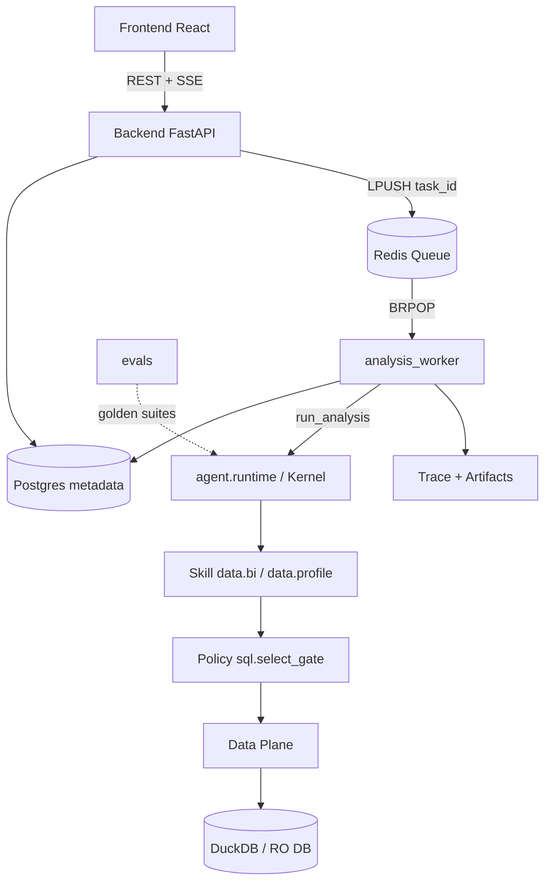

# PROJECT LEARNING GUIDE

**Enterprise Data Agent Platform** · 系统理解与学习手册  
**Audience:** 暂停开发、以理解为主的学习者  
**Companion docs:** [PLATFORM_CHARTER.md](../../architecture/PLATFORM_CHARTER.md) · [DIRECTORY_STRUCTURE.md](../../architecture/DIRECTORY_STRUCTURE.md) · [PLATFORM_CONTRACTS.md](../../architecture/PLATFORM_CONTRACTS.md) · [INTERVIEW_GUIDE.md](../interview/INTERVIEW_GUIDE.md) · [README.md](../../../README.md)

> 本手册只做理解与教学。不指导重构、不优化架构、不要求改代码。

---

## 如何使用本手册

| 阶段 | 目标 | 产出 |
|------|------|------|
| 第一阶段 | 建立全局认知 | 能口述「这是什么平台、脊柱是什么、和 ChatBI 差在哪」 |
| 第二阶段 | 代码地图 | 知道每个顶层目录解决什么问题、先读哪些文件 |
| 第三阶段 | 学习路线 | 按 Step 逐步读代码 + 跑一条真实链路 |
| 第四阶段 | 本文件 | 之后回看的 SSOT 学习入口 |

**文档权威顺序（冲突时）：**

1. `docs/FINAL_RELEASE.md` — 对外交付叙事  
2. `project_upgrade_plan.md` — 路线与进度  
3. `docs/PLATFORM_CHARTER.md` — 身份与红线  
4. 本手册 — 学习路径（不覆盖 Charter 合同）  
5. 历史 `PHASE_*` / `ERA_*` — 只读考古  

**当前仓库状态提示：** v1.0 Feature Freeze 已发布；工作区可能含 HITL H2（Approve → Resume → Execute）与前端审批面板的未提交实现。学习时以「脊柱不变、HITL 是 Run 生命周期扩展」为准。

---

# 第一阶段：全局认知

## 1. 项目定位

### 1.1 解决什么问题

企业里「用自然语言问数据」通常卡在三件事：

1. **正确性** — LLM 生成的 SQL 可能错、越权、或写操作  
2. **治理** — 谁跑了什么、失败原因是什么、能否取消/超时、能否人工审批后再执行  
3. **可扩展** — 今天是 Text-to-SQL，明天要 Dataset Profile / 其他 Data Skill，不能每做一个功能就重写一套系统  

本项目给出的答案不是「一个更聪明的聊天框」，而是：

> **一个可治理的 Enterprise Data Agent Platform（企业数据 Agent 平台）**  
> ChatBI / Text-to-SQL 只是跑在上面的第一个 **Data Skill**（`data.bi`）。

### 1.2 为什么这样设计

核心设计思想（与工程 Agent「RepoPilot」同构、领域不同）：

| 原则 | 含义 |
|------|------|
| **Platform ≠ Application** | 平台提供 Kernel / Policy / Trace / Run 治理；应用壳只是 Workspace / Dataset / Task UI |
| **Skill 可替换** | `data.bi` 与 `data.profile` 共用同一 Worker → Kernel → Policy → Plane → Trace 路径 |
| **Policy 先于执行** | SQL 必须过 `sql.select_gate`，再进 Data Plane；Plane 再做纵深防御 |
| **Worker 拥有终端状态** | Skill 不写 `succeeded` / `failed`；超时、取消、HITL 停等由 Worker 负责 |
| **诚实失败** | `failure_class`（`policy_denied` / `connector_error` / `hitl_rejected` / …）可观测、可评测 |
| **固定图，不自由环** | `data.bi` 用 LangGraph 固定流水线，不用 ReAct 自由探索 |

一句话：**别人卖「更聪明的对话」；本项目卖「可治理的数据分析 Run」。**

### 1.3 与普通系统的区别

| 对比对象 | 对方通常是什么 | 本项目差异 |
|----------|----------------|------------|
| **普通 ChatBI** | 对话 → SQL → 查库 → 出表/图 | ChatBI 降级为 Skill；之上有 Kernel 合同、Worker 生命周期、Trace/Artifact、Eval 门禁 |
| **RAG Chatbot** | 向量检索文档 → 生成答案 | 本项目**刻意不做 RAG 主路径**：答案来自受控 SELECT，正确性模型是 SQL/Gate，不是文档相似度 |
| **传统 BI** | 固定仪表盘、语义层、报表订阅 | 这里是 Agent Run：自然语言驱动、一次一问、全过程可审计；不是 Dashboard 产品 |
| **自由 Tool Agent** | LLM 随意选工具循环 | 工具白名单 + Policy；`sql.execute_select` 强制 Gate；禁止绕过 Facade |

**禁区（学习时记住「故意不做」）：** RAG 主路径、ReAct 自由环、Connector Framework、Celery（无证据不引入）、Code Agent、多云齐上。

---

## 2. 整体架构

### 2.1 架构脊柱（锁定）

```text
Frontend (Product Shell UI)
        ↓  HTTP + SSE
Backend API (Product Shell)
        ↓  Redis Queue
Worker (Run Governance)
        ↓  进程内函数调用
Agent Runtime / Kernel
        ↓
Skill (data.bi / data.profile)
        ↓
Policy (sql.select_gate)
        ↓
Data Plane (file→DuckDB | postgres_ro | mysql_ro)
        ↓
Trace / Artifact / Evaluation
```



### 2.2 各层详解

#### Frontend（Product Shell UI）

| 维度 | 说明 |
|------|------|
| **职责** | 登录、工作区、数据集、发起分析、看进度、HITL 审批、看 Trace/Artifacts |
| **输入** | 用户操作（上传 CSV、提问、Approve/Reject） |
| **输出** | REST 请求；订阅 SSE 事件流 |
| **为何独立** | UI 可变；平台合同在后端/Agent。前端不直接碰 Kernel 或 DuckDB |
| **通信** | `HTTP` → `/api/v1/...`；进度用 **SSE**（`/tasks/{id}/events`）。无 WebSocket；Redis 对前端不可见 |

#### Backend API（Product Shell）

| 维度 | 说明 |
|------|------|
| **职责** | 认证、Workspace/Dataset/Task CRUD、ACL、入队、SSE、HITL Approve/Reject、Execution/Artifact 投影 |
| **输入** | HTTP 请求；读 Postgres 元数据 |
| **输出** | JSON 响应；向 Redis `LPUSH` `task_id`（分析队列 / HITL resume 队列） |
| **为何独立** | API 线程**不执行** Skill / SQL；只编排与持久化。保证「执行在 Worker」 |
| **通信** | 入：HTTP；出：Redis；进度：SSE（轮询 DB 步骤/状态生成事件） |

#### Worker（Run Governance）

| 维度 | 说明 |
|------|------|
| **职责** | 认领任务、容量/超时/取消、HITL 停等与 Resume CAS、注入 `execute_select`、调用 Facade、落库 Trace/Artifact、写终端状态与 `failure_class` |
| **输入** | Redis `BRPOP` 拿到的 `task_id`；Postgres 中的 Task/Dataset |
| **输出** | 更新 Task 状态与 `result_json`；`agent_run_steps`；`run_artifacts` |
| **为何独立** | **终端状态归属 Worker**。Skill 不能自己宣布成功；超时/取消/HITL 与业务图解耦 |
| **通信** | Redis 入；进程内调用 `agent.runtime.run_analysis`；Postgres 写 |

#### Agent Runtime / Kernel

| 维度 | 说明 |
|------|------|
| **职责** | Skill 注册与调度；统一 `RunRequest` → `RunResult`；Tool/Policy 合同；Execution Trace 合并；Guardrails |
| **输入** | Worker 构造的 `AnalysisContext` / `RunRequest`（含注入的 `execute_select`） |
| **输出** | `AnalysisOutcome` / `RunResult`（artifacts、tool_calls、policy_decisions、limitations） |
| **为何独立** | 无 FastAPI/SQLAlchemy。可被 Eval 直接调用，不被 Product Shell 污染 |
| **通信** | 纯函数调用；**禁止** Worker 直接 import `graph` / `nodes` 绕过 Facade |

#### Skill

| 维度 | 说明 |
|------|------|
| **职责** | 领域能力包。`data.bi`：Schema Link → SQL → Gate → Execute → 摘要/图/报告。`data.profile`：确定性画像 |
| **输入** | Kernel 传入的 Run 上下文与 hints（含 HITL `hitl_plan_only` / `hitl_execute_only`） |
| **输出** | 中间步骤 + Artifacts；不写 DB 终端状态 |
| **为何独立** | 证明「换 Skill 不换平台」。第二 Skill 证明合同可复用，不是再堆一个聊天机器人 |
| **通信** | 经 Kernel Tool 调 Policy，再经注入回调进 Data Plane |

#### Data Plane

| 维度 | 说明 |
|------|------|
| **职责** | 只读 SELECT 执行器：`file`→DuckDB 文件；`postgres_ro`；可选 `mysql_ro` |
| **输入** | 已过 Gate 的 SQL + allowlist 上下文 |
| **输出** | 查询结果行集 / 连接错误（映射为 `connector_error`） |
| **为何独立** | **不是 Connector Framework**。凭证在 env（`POSTGRES_RO_DSN`），与平台元数据库 `DATABASE_URL` 分离 |
| **通信** | Worker 在 `agent_runtime` 按 `source_type` 绑定适配器，注入到 Context |

#### Trace / Artifact / Evaluation

| 维度 | 说明 |
|------|------|
| **职责** | **Trace**：工具调用、策略决策、步骤时间线。**Artifact**：summary/sql/table/chart/report 元数据。**Eval**：确定性黄金用例回归，进 Release Gate |
| **输入** | Kernel 产出 + Worker 封印（seal） |
| **输出** | `result_json.platform.execution`、`run_artifacts`、`evals/reports` |
| **为何独立** | 可审计 ≠ SIEM 产品；Eval ≠ 评测 SaaS。它们证明 Run 诚实与质量地板 |
| **通信** | Trace 嵌在 Task；API `GET .../execution` / `.../artifacts`；Eval 只调 Facade/Gate |

---

## 3. 核心业务流程

### A. 用户上传数据 → 生成分析结果

```text
1. FE: DatasetsPage 上传 CSV
2. API: POST /datasets/upload
   → 校验权限 → 写入 uploads → DuckDB 建表 ds_{dataset_id}
   → Dataset 元数据落 Postgres（source_type=file）
3. FE: AnalyzePage 填写问题 → createTask(dataset_id, question, skill_id=data.bi)
4. API: Task pending → Redis enqueue
5. Worker: claim → running
   → 绑定 execute_select(DuckDB)
   → run_analysis → Kernel → data.bi 全图
6. Worker: seal Trace/Artifacts → status=succeeded
7. FE: SSE terminal → 拉 execution + artifacts 展示
```

**关键点：** 上传只准备 Data Plane 的 **file** 平面；真正「分析」永远是一次 **Task/Run**。

**重点代码：**

- `frontend/src/pages/DatasetsPage.tsx` · `AnalyzePage.tsx`
- `backend/app/api/routes_datasets.py` · `routes_tasks.py`
- `backend/app/services/duckdb_service.py`
- `backend/app/workers/analysis_worker.py` · `agent_runtime.py`

---

### B. 自然语言问题 → SQL 执行

`data.bi` 固定图（`agent/graph.py`）：

```text
load_context
  → link_schema          # Schema Linking Lite（可失败）
  → generate_sql         # LLM 或启发式（Eval 强制关启发式）
  → validate_sql         # Policy sql.select_gate
  → execute_sql          # Tool → Gate 再一次 → Data Plane
  → summarize
  → build_charts
  → write_report
```

**Policy 纵深（学习时必懂）：**

1. Skill 节点 `validate_sql`  
2. Tool `sql.execute_select` 强制 Gate  
3. Plane（DuckDB/RO）执行前再 Gate  

非法 SQL → `policy_denied`，**不得**落到 Data Plane 成功执行。

**重点代码：**

- `agent/graph.py` · `agent/nodes/pipeline.py`
- `agent/skills/data_bi/skill.py`
- `agent/gates/sql_gate.py` · `agent/kernel/policies.py` · `agent/kernel/tools.py`
- `agent/schema_linking.py` · `agent/prompts_sql.py`

---

### C. HITL 审批流程

**开关：** `HITL_SQL_APPROVAL_ENABLED`（默认 **false**）+ 创建任务时 `require_sql_approval`（仅 `data.bi`）。

```text
Create Task (require_sql_approval=true)
  → Redis analysis queue
  → Worker: running, hitl_plan_only=True
  → Skill: link → generate → validate（Gate allow）
  → 禁止 execute_select（plan-only）
  → hitl_plan_done → END
  → Worker: park → status=awaiting_approval
       附着 SQL snapshot + sql_sha256
  → FE: HitlApprovalPanel 展示 SQL

Approve
  → API: CAS 设 hitl_resume_requested=true（状态仍可先保持 awaiting_approval）
  → Redis hitl_resume 队列（API 线程不执行 SQL）
  → Worker: CAS awaiting_approval → running（phase=execute）
  → 校验 sql_sha256（失败 → hitl_snapshot_mismatch，fail-closed）
  → hitl_execute_only + approved_sql（不得静默重生成不同 SQL）
  → execute → summarize → charts → report
  → seal → succeeded

并行出口：
  Reject  → failed / failure_class=hitl_rejected
  Cancel  → cancelled
  Wait timeout sweeper → timed_out
```

**不变量：**

- Policy Gate 回答「可不可以跑」；HITL 回答「人现在要不要跑」  
- 只有 Worker 翻转终端 / Resume 进入 execute  
- Approve **不在** API 请求里执行 SQL  

**重点代码：**

- `backend/app/services/task_service.py`（`approve_task` / `reject_task`）
- `backend/app/services/queue.py`（`enqueue_hitl_resume`）
- `backend/app/workers/analysis_worker.py`（`_mark_awaiting_approval` / `process_hitl_resume`）
- `agent/hitl_snapshot.py` · `agent/graph.py`（HITL 分支）
- `frontend/src/components/HitlApprovalPanel.tsx` · `frontend/src/lib/hitl.ts`

---

### D. Trace / Artifact 如何记录全过程

```text
运行中：
  Skill/Kernel 产生 StepRecord / tool_calls / policy_decisions
  Worker agent_runtime 写入 agent_run_steps（时间线）

终端封印 _seal_result_json（HITL park 时不按 succeeded 封印）：
  1. apply_trace_columns → Task 行上 skill_id / source_type / policy_denied 等
  2. artifact_service.materialize_for_task
       → run_artifacts 元数据 + content_ref 指向 result_json 热字段
  3. slim_for_persist → 控制 result_json 体积，保留 platform.execution

对外：
  GET /tasks/{id}/execution  → Execution Trace 投影
  GET /tasks/{id}/artifacts  → Artifact 列表（详情按需取 payload）
  SSE: step / status / terminal 事件驱动 UI
```

**兼容：** 前端仍可读传统 `result_json`（summary/sql/table_preview/charts/report）；平台字段在 `result_json.platform`。

**Eval：** `evals/` 用同一 Facade 跑黄金用例，检查 Gate / 执行 / Linking / Profile，**不**改边界。

**重点代码：**

- `agent/kernel/execution_trace.py`
- `backend/app/services/artifact_service.py` · `result_payload.py`
- `backend/app/services/task_service.py`（`get_execution_trace`）
- `evals/runner.py` · `evals/suites/core/cases.yaml`

---

# 第二阶段：代码地图

> 不逐文件解释。每个目录：**解决什么问题 → 核心文件 → 阅读顺序**。

## `frontend/` — Product Shell UI

**解决什么问题：** 给人用的工作台：认证、数据集、发起 Run、看进度、HITL、Trace。

**核心文件：**

| 文件 | 为何重要 |
|------|----------|
| `src/pages/AnalyzePage.tsx` | 创建任务 + SSE + HITL + 结果 |
| `src/pages/TasksPage.tsx` | 历史 Run / Trace |
| `src/pages/DatasetsPage.tsx` | 上传与 RO 绑定入口 |
| `src/api/tasks.ts` · `taskEvents.ts` | Task API + SSE |
| `src/components/HitlApprovalPanel.tsx` | 审批 UI |
| `src/types/task.ts` · `lib/hitl.ts` | 状态与 HITL 语义 |

**阅读顺序：** `README.md` → `types/task.ts` → `api/tasks.ts` → `AnalyzePage.tsx` → `HitlApprovalPanel.tsx` → `TasksPage.tsx`。

---

## `backend/` — API + Worker + Plane 适配

**解决什么问题：** Product Shell 服务端、队列、Run 治理、Data Plane 执行器、元数据持久化。

**核心文件：**

| 文件 | 为何重要 |
|------|----------|
| `app/main.py` | 路由装配 |
| `app/api/routes_tasks.py` · `routes_datasets.py` | HTTP 主表面 |
| `app/services/task_service.py` | 创建/审批/Trace 投影 |
| `app/services/queue.py` · `run_lifecycle.py` | 队列与状态词汇 |
| `app/workers/analysis_worker.py` | Run 生命周期心脏 |
| `app/workers/agent_runtime.py` | Shell ↔ Kernel 适配 + `execute_select` 注入 |
| `app/services/duckdb_service.py` | file 平面 |

**阅读顺序：** `README.md` → `run_lifecycle.py` → `queue.py` → `routes_tasks.py` → `task_service.py` → `analysis_worker.py` → `agent_runtime.py` → `duckdb_service.py`。

---

## `agent/` — Kernel + Skills

**解决什么问题：** 平台内核与领域 Skill；可被 Worker 与 Eval 共用；无 Web/ORM。

**核心文件：**

| 文件 | 为何重要 |
|------|----------|
| `runtime.py` | **唯一**对外 Facade（Worker 应只调这里） |
| `kernel/runtime.py` · `types.py` · `registry.py` | 调度与合同类型 |
| `kernel/policies.py` · `tools.py` · `execution_trace.py` | Gate / Tool / Trace |
| `skills/data_bi/skill.py` · `graph.py` · `nodes/pipeline.py` | BI 流水线 |
| `gates/sql_gate.py` | SELECT 策略实现 |
| `hitl_snapshot.py` | HITL SQL 快照哈希校验 |
| `skills/data_profile/` | 第二 Skill 证明合同 |

**阅读顺序：** `README.md` → `runtime.py` → `kernel/types.py` → `PLATFORM_CONTRACTS.md`（对照）→ `graph.py` → `nodes/pipeline.py`（先路由函数再节点）→ `gates/sql_gate.py` → `data_profile` 扫一眼。

---

## `evals/` — 质量地板

**解决什么问题：** 确定性回归（Gate / SQL / Linking / Profile）；Prompt 变更门禁；进 `smoke_release_gate`。

**核心文件：**

| 文件 | 为何重要 |
|------|----------|
| `README.md` | 模式与指标 |
| `runner.py` | 执行库 |
| `suites/core/cases.yaml` | CI/Release 核心 |
| `suites/quality/cases.yaml` | Schema Linking |
| `baselines/*_latest.json` | 回归地板 |

**阅读顺序：** `README.md` → `suites/core/cases.yaml`（读 3～5 个 case）→ `runner.py` 入口 → `docs/PROMPT_CHANGE_GATE.md`。

---

## `docs/` — 宪章、合同、阶段考古

**解决什么问题：** 身份、边界、运维、面试叙事、历史决策；代码的「为什么」。

**核心文件（先读）：**

| 文件 | 为何重要 |
|------|----------|
| `PLATFORM_CHARTER.md` | 平台是什么 / 非目标 |
| `PLATFORM_CONTRACTS.md` | RunRequest/Result、Artifact、Tool、Policy |
| `DIRECTORY_STRUCTURE.md` | 目录规范 |
| `DATA_PLANE.md` | 平面合同 |
| `FINAL_RELEASE.md` · `INTERVIEW_GUIDE.md` | 交付与讲解话术 |
| `OPS_RUNBOOK.md` · `OPS_CONFIG_MATRIX.md` | 如何跑起来 |
| HITL 系列 | `HITL_IMPLEMENTATION_PLAN.md` → H1/H2 Review |

**阅读顺序：** Charter → Contracts → DIRECTORY_STRUCTURE → DATA_PLANE → INTERVIEW_GUIDE → 按主题 HITL / OPS；`PHASE_*` 仅考古。

---

## 其他顶层（略读）

| 目录 | 作用 |
|------|------|
| `docker/` | Compose：API + Worker + Postgres + Redis + 可选 RO/Nginx/观测 |
| `database/` | 数据约定说明 |
| `data/` | 本地 DuckDB 等运行时数据（勿当源码读） |

---

# 第三阶段：学习路线（推荐 10 Step）

## Step 1 — 建立身份模型

| | |
|--|--|
| **学习目标** | 能用一句话说清：这是 Data Agent **平台**，ChatBI 是 Skill |
| **概念** | Platform / Kernel / Skill / Run Governance / Data Plane / Product Shell |
| **重点位置** | `README.md` · `docs/PLATFORM_CHARTER.md` · `docs/INTERVIEW_GUIDE.md` §1–3 |

## Step 2 — 吃透合同

| | |
|--|--|
| **学习目标** | 画出 RunRequest → RunResult；列出 Artifact 类型与 Tool 列表 |
| **概念** | skill_id、policy_context、tool_calls、policy_decisions、result_json 兼容投影 |
| **重点位置** | `docs/PLATFORM_CONTRACTS.md` · `agent/kernel/types.py` |

## Step 3 — 跟一条「创建任务」HTTP 路径

| | |
|--|--|
| **学习目标** | 从 `POST /tasks` 找到入队，确认 API 不跑 Skill |
| **概念** | pending、enqueue、TaskOut、SSE 与 Worker 分离 |
| **重点位置** | `routes_tasks.py` · `task_service.create_task` · `queue.py` |
| **建议操作** | 打开 OpenAPI `/docs`，只读 Tasks/Datasets 模型 |

## Step 4 — Worker 认领与终端状态

| | |
|--|--|
| **学习目标** | 理解「谁有权写 succeeded/failed/timed_out/cancelled/awaiting_approval」 |
| **概念** | claim CAS、timeout、cancel token、write fence、failure_class、seal |
| **重点位置** | `run_lifecycle.py` · `analysis_worker.process_task` · `_seal_result_json` |

## Step 5 — Facade → Kernel → Skill

| | |
|--|--|
| **学习目标** | 证明 Worker 只应调用 `run_analysis`；Kernel 如何 dispatch |
| **概念** | AnalysisContext、RunRequest、registry、AnalysisOutcome |
| **重点位置** | `agent/runtime.py` · `agent/kernel/runtime.py` · `agent/skills/data_bi/skill.py` |

## Step 6 — data.bi 图与 SQL Gate

| | |
|--|--|
| **学习目标** | 默画节点顺序；说明 Gate 三层为什么存在 |
| **概念** | Schema Linking、repair/retry、policy_denied、纵深防御 |
| **重点位置** | `agent/graph.py` · `nodes/pipeline.py` · `gates/sql_gate.py` · `kernel/tools.py` |
| **建议操作** | 读一个 Eval `sql_inject` deny case，对照 Gate 行为 |

## Step 7 — Data Plane 注入

| | |
|--|--|
| **学习目标** | 说清 file / postgres_ro 如何进到 Skill，且 Skill 不 import Shell |
| **概念** | source_type、execute_select 回调、DSN 与 DATABASE_URL 分离 |
| **重点位置** | `agent_runtime.py` · `duckdb_service.py` · `docs/DATA_PLANE.md` · `agent/data_plane.py` |

## Step 8 — Trace / Artifact 闭环

| | |
|--|--|
| **学习目标** | 从一次成功 Run 指出 Trace 存在哪、Artifact 如何引用热字段 |
| **概念** | platform.execution、agent_run_steps、content_ref、slim |
| **重点位置** | `execution_trace.py` · `artifact_service.py` · `get_execution_trace` |
| **建议操作** | UI Tasks 页打开一条成功任务的 Execution / Artifacts |

## Step 9 — HITL 全链路（可选，但强烈推荐）

| | |
|--|--|
| **学习目标** | 口述 Plan → awaiting → Approve → Resume → Execute → Result |
| **概念** | hitl_plan_only、snapshot sha256、resume 队列、CAS、execute-only |
| **重点位置** | HITL 设计/实现文档 · `approve_task` · `process_hitl_resume` · `hitl_snapshot.py` · `HitlApprovalPanel.tsx` |
| **建议操作** | `.env` 打开 `HITL_SQL_APPROVAL_ENABLED`，Analyze 勾选审批，走通一次 Approve（需本机 API+Worker） |

## Step 10 — Eval 与 Release Gate

| | |
|--|--|
| **学习目标** | 理解质量地板如何锁住 Prompt/Gate 回归 |
| **概念** | core/quality/profile suites、baseline、PROMPT_SQL_VERSION |
| **重点位置** | `evals/README.md` · `suites/core/cases.yaml` · `backend/scripts/smoke_release_gate.py` · `docs/PROMPT_CHANGE_GATE.md` |
| **建议操作** | `python scripts/smoke_eval_golden.py --suite core`（在 backend venv 中） |

---

# 第四阶段：学习检查清单

学完后，你应能不看文档回答：

- [ ] 为什么说「ChatBI 不是平台定义」？  
- [ ] 脊柱七层各自分工与通信方式？  
- [ ] 为什么 Worker 与 Kernel 必须分开？  
- [ ] SQL 从生成到执行经过哪些强制检查？  
- [ ] HITL 与 Policy Gate 各回答什么问题？  
- [ ] Trace 和 Artifact 存在哪里、API 怎么读？  
- [ ] Eval 测的是产品 UI 还是平台合同？  
- [ ] 打开任意目录时，第一批该读哪 3～5 个文件？  

---

# 附录 A — 最小运行路径（理解用）

```powershell
# 1) 环境
copy .env.example .env
# 演示建议 ANALYSIS_RUNTIME=agent

# 2) 依赖栈
docker compose -f docker/docker-compose.yml --env-file .env up -d --build

# 3) 前端
cd frontend
npm install
npm run dev
```

细节见 `docs/OPS_RUNBOOK.md`。学习阶段优先「跟一条请求」，不必一次打开所有 Wave 特性（OIDC/MCP/MySQL 等可后置）。

---

# 附录 B — 概念速查

| 术语 | 一句话 |
|------|--------|
| **Kernel** | Skill/Tool/Policy/Artifact 注册与 `run` 调度 |
| **Skill** | 领域能力包（`data.bi` / `data.profile`） |
| **Run** | 一次任务执行实例（Task） |
| **Policy / Gate** | 执行前确定性策略（SELECT-only + allowlist） |
| **Data Plane** | Gate 之后的只读执行器 |
| **Facade** | `agent.runtime.run_analysis`，Shell 唯一入口 |
| **failure_class** | 失败分类，便于治理与评测 |
| **HITL** | 人工审批后再执行；不替代 Gate |
| **Trace** | 工具/策略/步骤审计投影 |
| **Artifact** | 类型化产出元数据 |
| **Eval** | 确定性黄金回归，非评测产品 |

---

# 附录 C — 与本手册相关的「下一步学习」建议顺序

1. 本手册第一～三阶段（先读后跑）  
2. 对照 `docs/PLATFORM_STORY_REVIEW.md` 看演进叙事（可选）  
3. HITL：`HITL_IMPLEMENTATION_PLAN.md` → H1 Report → H2 Design/Review  
4. 运维：`OPS_CONFIG_MATRIX.md`（只关心你本机会改的变量）  
5. 面试表达：`RESUME_HIGHLIGHTS.md` + `INTERVIEW_GUIDE.md`

---

**End of PROJECT_LEARNING_GUIDE.**
