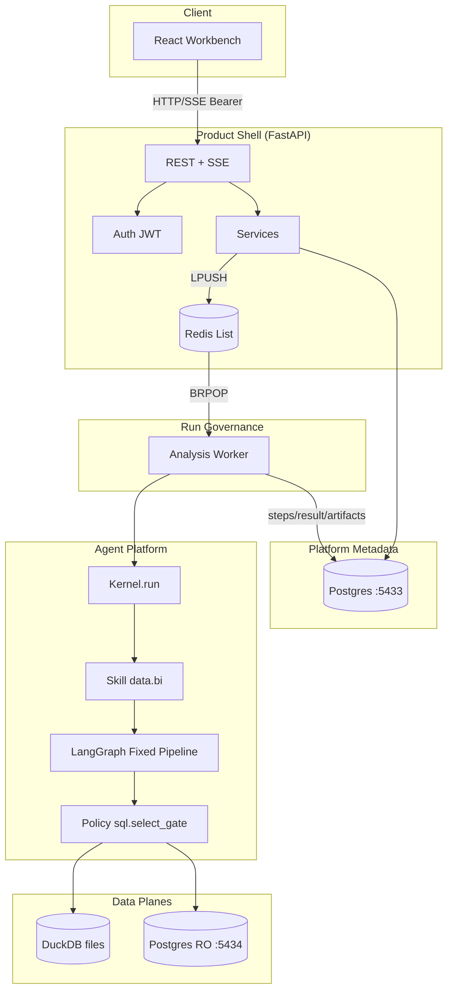
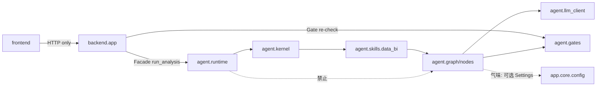
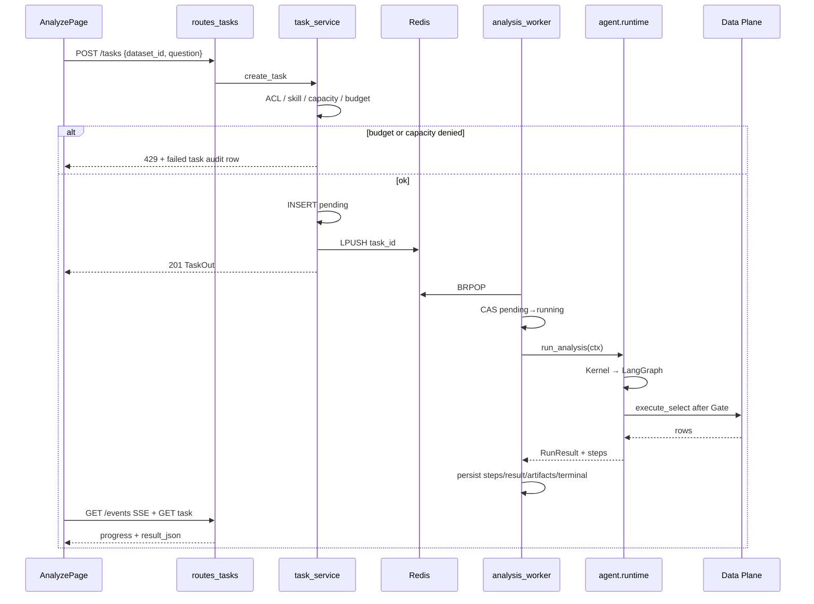
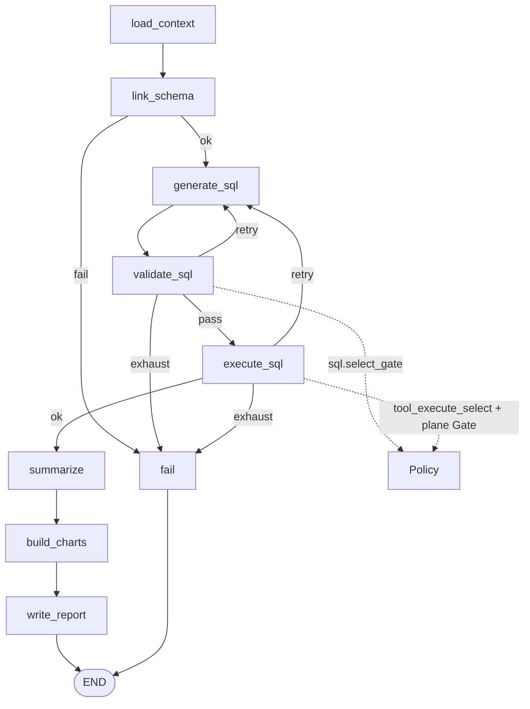
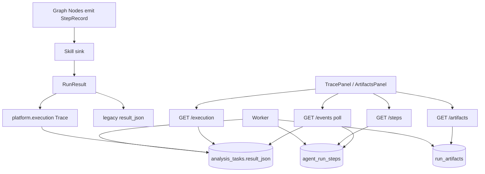
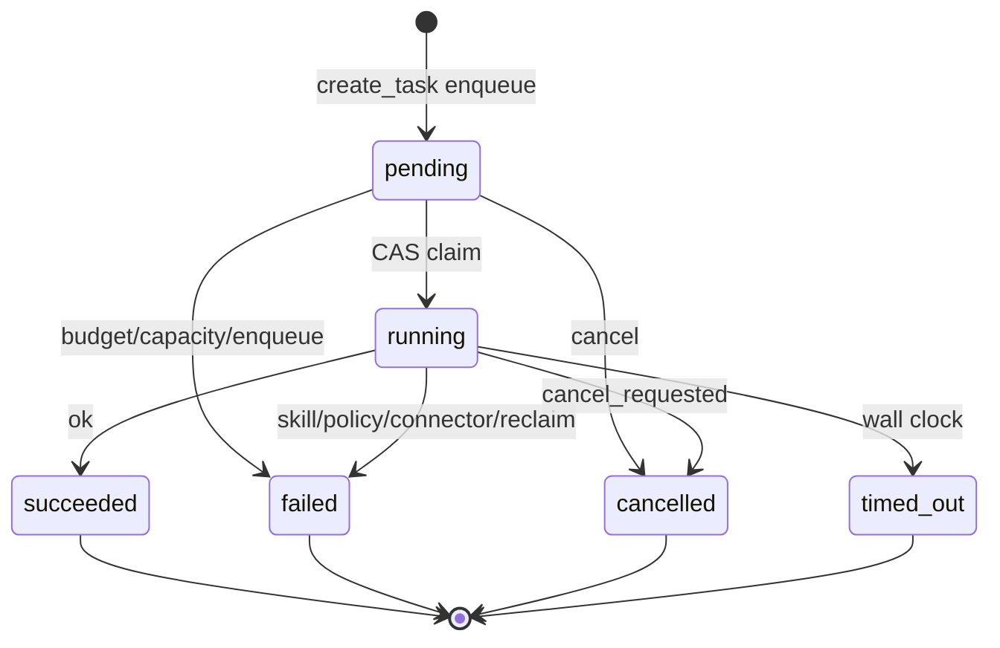

# Enterprise Data Agent Platform — 技术升级与架构深析

**文档类型：** 架构深析 · 优化目录 · 实施路线图（**唯一开发依据 / SSOT**）  
**日期：** 2026-07-22（v2 — 深度架构修订）  
**角色：** Tech Lead + AI Architect  
**状态：** **Release v1.0 Feature Freeze** · Wave 0–3 + Stabilization **已完成** · Wave 4 **未启动**  
**规则：** 无明确新需求 → **不改代码、不加功能**

**架构锁定（不可推翻）：**

```text
Product Shell → Worker → Kernel → Skill → Policy → Data Plane → Trace / Artifacts
```

**父母文档：**  
[`docs/PLATFORM_CHARTER.md`](docs/PLATFORM_CHARTER.md) · [`docs/PLATFORM_CONTRACTS.md`](docs/PLATFORM_CONTRACTS.md) · [`docs/FINAL_TECH_REVIEW.md`](docs/FINAL_TECH_REVIEW.md) · [`docs/FINAL_STABILIZATION_REVIEW.md`](docs/FINAL_STABILIZATION_REVIEW.md)

---

## 执行摘要

| 结论 | 说明 |
|------|------|
| **产品身份** | Governed Enterprise Data Agent Platform，不是 ChatBI 玩具、不是 RAG 聊天机器人、不是 Multi-Agent OS |
| **最强资产** | Kernel/Skill/Policy/Plane/Trace 脊柱清晰；三重 SQL Gate；Run 诚实性；Eval 门禁；≥2 Skills |
| **当前缺口** | 单云 IaC / 生产 SSO 联调 / Refresh 吊销 / 大 `result_json` 归档（Wave 4+） |
| **升级原则** | 只加强化脊柱的能力；热门技术若冲突或稀释叙事 → **明确不换/不做** |
| **本文用途** | 后续所有开发以本文 **Implementation Roadmap** 为唯一依据 |

> **企业级 ≠ 技术清单全开。** 企业级首先是边界清晰、可治理、可证明、可运维。

---

# 第一部分：全面架构梳理

## 1.1 目录职责地图

| 路径 | 作用（一句话） |
|------|----------------|
| `frontend/` | React + TS 产品壳：登录、数据集、Analyze、Tasks、Trace/Artifacts UI |
| `frontend/src/api/` | 仅 HTTP/SSE 客户端（Bearer JWT），不触碰 agent 包 |
| `frontend/src/pages/` | 路由页面（Home / Login / Register / Dashboard / Datasets / Analyze / Tasks） |
| `frontend/src/components/` | ExecutionTrace / Artifacts / Result / Chart / Report 面板 |
| `frontend/src/stores/` | 轻量 auth 状态（localStorage token） |
| `backend/` | FastAPI Product Shell + Worker + Data Plane + Alembic |
| `backend/app/api/` | REST：auth / workspaces / datasets / tasks / health |
| `backend/app/services/` | 业务服务：task/queue/lifecycle/budget/ACL/DuckDB/postgres_ro/artifacts/SSE |
| `backend/app/workers/` | Redis 消费者 + 向 `agent.runtime` 的适配层 |
| `backend/app/models/` | SQLAlchemy 模型（当前单文件聚合） |
| `backend/app/core/` | Settings / DB / Security / 存储路径 / 可观测日志 |
| `backend/app/schemas/` | Pydantic API 契约 |
| `backend/alembic/` | **真实** schema 演进（`database/` 仅约定说明） |
| `backend/scripts/` | smoke / release gate / eval 驱动脚本 |
| `agent/` | Kernel + Skill `data.bi`（无 FastAPI/SQLAlchemy 持久化责任） |
| `agent/kernel/` | `run`、registry、tools、policies、execution_trace 类型 |
| `agent/skills/data_bi/` | 第一 Skill：包装固定 LangGraph |
| `agent/nodes/` | 图节点实现（load → link → generate → validate → execute → …） |
| `agent/gates/` | 确定性 `sql.select_gate` |
| `agent/llm_client.py` + `llm.py` | HTTP LLM 客户端 + Facade（含可选 Settings 读取） |
| `evals/` | Golden suites（`core` / `quality` / `llm`）+ runner |
| `docker/` | Compose：平台 Postgres、Redis、RO Demo Postgres、API/Worker 镜像 |
| `data/` | 运行时 uploads + 每 workspace DuckDB 文件 |
| `database/` | 数据约定文档（迁移不在此） |
| `docs/` | Charter / Contracts / 阶段冻结 / Ops / 复盘 |
| `.github/workflows/` | CI release gate（非 CD） |

---

## 1.2 模块依赖关系

### 允许的依赖方向

```text
frontend ──HTTP/SSE──► backend.app (Product Shell)
backend.workers ──────► agent.runtime.run_analysis   ✅ Facade
backend.data_plane ───► agent.gates.sql_gate         ✅ 纵深防御（再 Gate）
backend.health/skills ─► agent.kernel.registry       ✅ Lifecycle lite
agent.skill/graph ────► agent.gates / llm / linking  ✅ 包内
```

### 禁止的依赖方向

| 禁止 | 原因 |
|------|------|
| Worker / Shell → `agent.graph` / `nodes` / `skills` 内部 | 破坏 Facade；合同写在 `agent/runtime.py` |
| Agent → SQLAlchemy / FastAPI / Redis | Kernel 不拥有 Run 持久化与队列 |
| Frontend → Python / agent | 浏览器只认 API |

### 已知耦合气味（不立即重构，记入优化目录）

| 气味 | 证据 | 风险 |
|------|------|------|
| `agent.llm` 可选 `import app.core.config` | `agent/llm.py` | Agent 包对 Shell Settings 泄漏 |
| Data Plane 直接依赖 `agent.gates` | `duckdb_service` / `postgres_ro_service` | Shell↔Agent 包布局耦合（有意纵深防御） |
| Steps 批末落库 | Worker 在 `run_analysis` 返回后写 `agent_run_steps` | SSE「步骤」并非真·节点级流式 |
| `Dataset.duckdb_table` 名被 RO 平面复用 | 存 `public.x` | 概念命名债务 |

---

## 1.3 请求流（Analyze 端到端）

```text
AnalyzePage.onSubmit
  → POST /api/v1/workspaces/{id}/tasks
  → task_service.create_task
       · dataset ready?
       · RUN_CREATE / SKILL_INVOKE / ACL
       · skill_lifecycle.assert_skill_invokable("data.bi")
       · runtime_essentials.assert_enqueue_allowed
       · cost_budget.assert_budget_allowed  ──否──► failed + budget_rejected + HTTP 429
       · INSERT analysis_tasks (pending)
       · Redis LPUSH analysis_queue_key
  → Worker BRPOP → process_task
       · CAS pending→running + heartbeat
       · run_agent_analysis → agent.runtime.run_analysis
       · 落库 steps / result_json / artifacts / 终态
  → UI: SSE /events + GET task + /execution + /steps + /artifacts
```

### 主要 API 面

| 前缀 | 关键端点 |
|------|----------|
| `/api/v1/auth` | `register` · `login` · `me` |
| `/api/v1/workspaces` | list / get / patch |
| `.../datasets` | list · upload · postgres-ro · preview · acl |
| `.../tasks` | create · list · get · execution · steps · artifacts · events(SSE) · cancel |
| `/health` | `live` · `ready` · legacy `/health` |

---

## 1.4 数据流

### 文件平面（CSV/XLSX → DuckDB）

```text
Upload → data/uploads/{ws}/{dataset_id}_*
      → datasets(status=processing, source_type=file)
      → duckdb_service.import_file
      → data/duckdb/{workspace_id}.duckdb 表 ds_{uuid}
      → schema_json + row_count + status=ready
```

### Postgres RO 平面

```text
Bind API → postgres_ro_service.probe_and_describe
        → DSN 仅来自 POSTGRES_RO_DSN（不进 Dataset 明文）
        → ≤2 public.* allowlist · SESSION READ ONLY
        → datasets(source_type=postgres_ro, source_config_json.allowed_tables, ready)
```

### 执行与结果

```text
Worker 注入 execute_select(file|postgres_ro)
  → Skill tool_execute_select → Policy Gate
  → Plane run_select → 再次 Gate → 引擎 SELECT
  → RunResult → to_legacy_result_json + platform.execution / sql_quality / authorization
  → analysis_tasks.result_json + run_artifacts
```

`result_json` 核心形状：`summary` · `sql` · `table_preview` · `charts` · `report` · `limitations` · `platform{skill, execution, run, data_plane, authorization, sql_quality}`。

---

## 1.5 AI 调用流程

```text
link_schema (schema_linking: token-overlap lite)
    │ fail → fail node
    ▼
generate_sql
    → prompts_sql.build_text_to_sql_prompts
    → llm.chat_completion_result
        → LLMClient.chat → POST {LLM_BASE_URL}/chat/completions
        → 传输层 retry（429/5xx/timeout）
    → schemas_llm.parse_sql_draft (JSON Schema)
    → 无 key 且允许时：heuristic SQL（Eval 强制关闭）
    ▼
validate_sql → sql_gate.validate_and_normalize_sql
    │ deny + retry_count ≤ max_retries → generate_sql
    │ deny + 耗尽 → fail
    ▼
execute_sql → tool_execute_select → Gate → Plane
    │ exec fail + retries → generate_sql
    ▼
summarize → build_charts → write_report → END
```

**两套重试互不混淆：**

| 层 | 重试对象 | 所有者 |
|----|----------|--------|
| LLM 传输 | HTTP/429/5xx | `LLMClient` |
| SQL 生成 | Gate/执行失败后的再生成 | LangGraph conditional edges |

---

## 1.6 Trace 流程

| 层 | 机制 | 真相级别 |
|----|------|----------|
| **节点 Step** | `_emit(StepRecord)` → Skill sink | 内存中（Run 内） |
| **持久化** | Worker 写 `agent_run_steps` | DB 时间线 |
| **Execution Trace** | `to_execution_trace` → `platform.execution`；`GET .../execution` | **产品审计真相** |
| **SSE** | `GET .../events` 轮询 Task/Steps | UX 进度（非 token 流） |
| **Artifacts** | `run_artifacts` + `content_ref` | 可引用产出物 |
| **不完整标记** | cancel/timeout/reclaim → `execution.summary.incomplete=true` | Run 诚实性 |

**重要约束：** 步骤在 agent 调用结束后批量落库；长 LLM 调用期间 SSE 主要看到 `running` + heartbeat，而非逐节点推送。

---

## 1.7 Run 生命周期

### 状态机

```text
                 ┌─ budget/capacity/enqueue 失败 ─► failed (terminal)
pending ─────────┤
  │              └─ cancel ─► cancelled
  │ CAS claim
  ▼
running ──┬─ success ─► succeeded
          ├─ skill/policy/connector ─► failed (+ failure_class)
          ├─ cancel_requested ─► cancelled
          ├─ wall-clock timeout ─► timed_out
          └─ stale reclaim ─► failed (runtime_reclaimed)
```

- `ACTIVE = {pending, running}`
- `TERMINAL = {succeeded, failed, cancelled, timed_out}`
- **无自动重跑**；重跑 = 新 Task

### `failure_class` 一览

| 值 | 含义 |
|----|------|
| `enqueue_error` | Redis 入队失败 |
| `capacity_rejected` | 队列深 / in-flight 帽 |
| `budget_rejected` | Workspace 日 token 软预算 |
| `policy_denied` | SQL Gate / Policy |
| `connector_error` | 数据面连接/执行器 |
| `skill_error` | Skill/LLM/管线默认失败 |
| `timeout` / `cancelled` / `runtime_reclaimed` | 治理终态 |
| `internal_error` / `unknown` | 预留/兜底 |

### 治理原语

| 原语 | 行为 |
|------|------|
| Heartbeat | running 等待线程时 `touch_heartbeat` |
| Timeout | 线程池墙钟；**协作式**，不保证立刻杀死 LLM/DB |
| Cancel | pending 立即终态；running 设旗后协作退出 |
| Reclaim | 空闲 BRPOP / claim 前回收僵死 running |
| Budget | 入队前拒绝并落审计 failed 行 |
| Capacity | 入队 429；claim 时可 defer + requeue |

---

# 第二部分：架构图（Markdown + Mermaid）

## 2.1 系统总览



## 2.2 依赖边界



## 2.3 Analyze 请求时序



## 2.4 AI / Policy 管线



## 2.5 Trace / SSE / Artifacts 关系



## 2.6 Run 生命周期状态机



---

# 第三部分：当前设计已优于流行方案（勿盲目替换）

> 热门 ≠ 正确。下列选择在本产品身份下 **已经更好**，Roadmap **禁止**为追热点而替换。

| 当前设计 | 流行替代 | 为什么当前更好 | 证据 |
|----------|----------|----------------|------|
| **固定 LangGraph Skill 图** | ReAct / 自由 Tool Loop | 路径可回归、Policy 必经、Run 诚实；自由环破坏 allowlist 纪律 | `agent/graph.py`；Charter Won't Do |
| **Policy-before-execute（三重 Gate）** | 「模型说了就算」或仅 prompt 约束 | 确定性拒绝可审计；引擎前再 Gate | validate 节点 + `tool_execute_select` + plane `run_select` |
| **Worker 拥有 timeout/cancel** | 把治理塞进 LLM Agent 框架 | Kernel≠运维；失败类别清晰 | `analysis_worker.py` + Charter §6 |
| **Redis List + 显式 Worker** | Celery/Kafka「一上就企业」 | Demo 规模足够；生命周期可见、无 broker 魔法 | `queue.py` LPUSH/BRPOP |
| **Trace 为产品真相** | LangSmith 双轨 / 仅日志 | 租户内可查、与 Run 同生命周期、无厂商锁定 | `platform.execution` + `agent_run_steps` |
| **SSE 任务进度** | WebSocket 聊天通道 / token streaming | 产品是 Run 不是 Chat；避免泄漏中间推理 | `task_events.py` |
| **自研 LLMClient + JSON Schema** | LangChain 全家桶 | 依赖面小、错误类型可控、与固定图正交 | `llm_client.py` / `schemas_llm.py` |
| **绑定数据面 Text-to-SQL** | RAG + Vector DB 知识库 | 问题域是表上的受控 SQL，不是 chunk 问答；RAG 会改产品定义 | Charter Non-goals |
| **平台库 ≠ RO 数据面 DSN** | 单库混用 | 凭证隔离、最小权限、平面叙事清晰 | `POSTGRES_RO_DSN` vs `DATABASE_URL` |
| **Soft budget + capacity 入队拒绝** | 先跑再看账单 | 有 `failure_class` 审计行，企业「可限制」叙事成立 | `cost_budget.py` / `runtime_essentials.py` |
| **Eval golden 进 CI** | 只靠 Demo 手感 | Prompt 变更可证伪 | `evals/` + release gate |
| **单前端 React** | React+Vue 双栈 | 一份工作台叙事更强；双栈无产品收益 | `frontend/package.json` |
| **Compose 一键 Demo** | 直接上 K8s | 先证明脊柱与可重复 Demo，再谈编排平台 | `docker/docker-compose.yml` |

**替换门禁：** 只有当 Metrics/负载/合规证据证明当前方案成为瓶颈，且替代方案不破坏脊柱不变量时，才允许进入 P2/P3 评估。

---

# 第四部分：优化目录（按域）

难度：1=很易 … 5=很难。优先级：P0/P1/P2/P3。  
凡标 **不做** 的项不进入 Implementation Roadmap。

## 4.1 架构优化

| ID | 建议 | 为什么需要 | 解决什么问题 | 企业最佳实践？ | 难度 | 优先级 | 工作量 |
|----|------|------------|--------------|----------------|------|--------|--------|
| A1 | 消除 `agent.llm`→`app.core.config` 泄漏：改为 Worker 注入 retry 配置 | 恢复 Agent 包可独立测试/复用 | 隐藏耦合、测试需整 app | ✅ 依赖单向 | 2 | P1 | 1–2 天 |
| A2 | Data Plane Gate 依赖改为共享纯函数包或接口注入 | 降低 Shell↔agent 布局耦合 | 包边界清晰 | ✅ 可选；纵深防御可保留 | 3 | P2 | 3–5 天 |
| A3 | 拆分 `models/__init__.py` 按域分模块 | 单文件将随表增长难维护 | 可维护性 | ✅ | 2 | P1 | 2–3 天 |
| A4 | 统一 `primary_relation` 命名，摆脱 `duckdb_table` 误用 | 消除 RO/文件平面概念混淆 | 可读性/新人成本 | ✅ | 2 | P2 | 2–4 天（含迁移别名） |
| A5 | 第二 Skill 前冻结 Skill Charter + Eval 合同 | 防止平台叙事空转 | 「可扩展」可证明 | ✅ | 3 | P2 | 1 周（含设计） |
| A6 | ~~引入微服务拆分 API/Agent~~ | — | — | ❌ 过早 | — | **不做** | — |
| A7 | ~~ReAct 替换固定图~~ | — | — | ❌ 冲突脊柱 | — | **不做** | — |

## 4.2 AI 能力优化

| ID | 建议 | 为什么需要 | 解决什么问题 | 企业实践？ | 难度 | 优先级 | 工作量 |
|----|------|------------|--------------|------------|------|--------|--------|
| AI1 | Schema Linking v2：同义词表 + 召回指标进 Trace/Eval | 列选错是准确率第一瓶颈 | 宽表/业务黑话 | ✅ | 3 | P1 | 1–2 周 |
| AI2 | SQL Repair 失败分类 + 成功率度量 | 「再生成」不可优化 | 盲目重试浪费 token | ✅ | 3 | P1 | 4–7 天 |
| AI3 | Eval 语义题集扩展（含可选 llm suite） | 质量不可证伪则一切 AI 改动危险 | 回归门禁 | ✅ | 3 | P0 | 4–7 天 |
| AI4 | Prompt 版本与 Eval 绑定 | Prompt 漂移无审计 | 变更可追溯 | ✅ | 2 | P0 | 2–3 天 |
| AI5 | 多模型 Provider 薄适配（OpenAI-compat / Claude / Gemini） | 单厂商风险 | 切换与成本路由 | ✅ | 3 | P1 | 1 周 |
| AI6 | 受控 Workspace Memory（成功列映射/同义词） | 非聊天记忆，服务 linking | 个性化准确率 | ✅ 薄做 | 3 | P2 | 1–2 周 |
| AI7 | Guardrails：输出 PII/列敏感标签薄层 | 企业数据外泄面 | 合规叙事 | ✅ | 3 | P2 | 1 周 |
| AI8 | MCP 只读工具适配（旁路，强制走 Policy） | 生态对齐 | 标准工具面 | 🟡 可选 | 4 | P2 | 2–3 周 |
| AI9 | ~~RAG / Vector DB 主路径~~ | 改产品定义 | — | ❌ | — | **不做** | — |
| AI10 | ~~LangChain/LlamaIndex 重写~~ | 双栈无收益 | — | ❌ | — | **不做** | — |
| AI11 | ~~Fine-tune / 多模态主线~~ | ROI 远低于 Eval+Linking | — | 过早 | 5 | **P3 观察** | — |
| AI12 | ~~Multi-Agent 编排（无第二 Skill）~~ | 戏剧化 | — | ❌ 过早 | — | **不做**（第二 Skill 后再评估） | — |

## 4.3 Backend 优化

| ID | 建议 | 为什么需要 | 解决什么问题 | 企业实践？ | 难度 | 优先级 | 工作量 |
|----|------|------------|--------------|------------|------|--------|--------|
| B1 | API Rate Limit（login / tasks） | 防刷与成本 | 滥用 | ✅ | 2 | P0 | 2–4 天 |
| B2 | Worker HTTP health / 就绪探针 | Compose/K8s 需要 | 僵死不可见 | ✅ | 2 | P1 | 1–2 天 |
| B3 | SSE `Last-Event-ID` + 前端自动重连 | 断线体验 | 假死进度 | ✅ | 2 | P1 | 2–3 天 |
| B4 | 可选：步骤增量落库（中长 Run） | SSE 更真实 | 长 LLM 黑盒 | 🟡 | 4 | P2 | 1 周 |
| B5 | 全面 Async 化 | 仅负载证据后 | 吞吐 | 🟡 过早则否 | 5 | P2 条件 | 2–4 周 |
| B6 | Celery/RQ 迁移 | 仅 Metrics 证明瓶颈后 | 水平扩展 | 🟡 | 4 | P2 条件 | 2–3 周 |
| B7 | ~~WebSocket 替换 SSE~~ | 无第二实时面 | — | ❌ | — | **不做** | — |

## 4.4 数据库优化

| ID | 建议 | 为什么需要 | 解决什么问题 | 企业实践？ | 难度 | 优先级 | 工作量 |
|----|------|------------|--------------|------------|------|--------|--------|
| D1 | 为 `analysis_tasks` 高频过滤列补齐索引（status/workspace/created）审计 | 列表变慢 | 查询性能 | ✅ | 2 | P1 | 1–2 天 |
| D2 | `result_json` 大字段归档策略（热/冷） | 表膨胀 | 存储与备份 | ✅ 规模后 | 3 | P2 | 1 周 |
| D3 | DuckDB 多副本拓扑写入 Runbook 约束 | 共享盘一致性 | 数据损坏风险 | ✅ | 2 | P1 | 1 天（文档+断言） |
| D4 | 薄 MySQL RO 平面（证明 Plane 抽象） | 单引擎叙事弱 | 可扩展证明 | 🟡 | 3 | P2 | 2–3 周 |
| D5 | ~~主路径上 Vector DB~~ | — | — | ❌ | — | **不做** | — |
| D6 | Elasticsearch 仅用于审计检索 | 运维检索 | Trace 搜索 | 🟡 | 3 | P3 | 1–2 周 |

## 4.5 API 设计优化

| ID | 建议 | 为什么需要 | 解决什么问题 | 企业实践？ | 难度 | 优先级 | 工作量 |
|----|------|------------|--------------|------------|------|--------|--------|
| API1 | 错误码矩阵文档化（429 failure_class 对齐） | 客户端可分支 | 前端/集成混乱 | ✅ | 1 | P0 | 1 天 |
| API2 | OpenAPI 示例与契约测试（schemathesis 或 smoke） | 防回归破坏 | 契约漂移 | ✅ | 2 | P1 | 3–5 天 |
| API3 | 分页/过滤一致性（tasks/datasets） | 列表规模 | UX | ✅ | 2 | P1 | 2–3 天 |
| API4 | Idempotency-Key 创建 Task（可选） | 网络重试双入队 | 重复 Run | ✅ | 3 | P2 | 3–5 天 |

## 4.6 安全优化

| ID | 建议 | 为什么需要 | 解决什么问题 | 企业实践？ | 难度 | 优先级 | 工作量 |
|----|------|------------|--------------|------------|------|--------|--------|
| S1 | JWT 短 TTL + Refresh；禁弱默认 secret | 长生命周期 token 风险 | 会话安全 | ✅ | 3 | P0 | 3–5 天 |
| S2 | CORS / 密钥启动校验 / heuristic 生产默认关 | Demo 开关泄漏 | 错误配置上线 | ✅ | 2 | P0 | 1–2 天 |
| S3 | Rate Limit（见 B1） | 暴力破解/刷 Analyze | 滥用 | ✅ | 2 | P0 | 含 B1 |
| S4 | Secret Management（SOPS/云 Secret） | `.env` 明文习惯 | 密钥泄漏 | ✅ | 3 | P1 | 3–5 天 |
| S5 | OIDC/OAuth2（一家 IdP） | 企业 SSO | 账号治理 | ✅ | 3 | P2 | 1–2 周 |
| S6 | 表级 ACL ↔ Policy allowlist 投影 | 权限与 Gate 双故事 | 最小权限 | ✅ | 3 | P2 | 2–3 周 |
| S7 | HttpOnly Cookie 方案评估（替代 localStorage） | XSS 偷 token | 前端存储风险 | ✅ | 3 | P1 | 3–5 天 |

## 4.7 性能优化

| ID | 建议 | 为什么需要 | 解决什么问题 | 企业实践？ | 难度 | 优先级 | 工作量 |
|----|------|------------|--------------|------------|------|--------|--------|
| PFM1 | Linking 降低 prompt token | 宽表贵且慢 | 成本/延迟 | ✅ | 2 | P1 | 随 AI1 |
| PFM2 | per-workspace 并发帽（有争用证据后） | 全局 in-flight 不公平 | 多租户尾延迟 | ✅ | 3 | P2 | 3–5 天 |
| PFM3 | LLM 超时与 SQL 墙钟分层配置 | 长尾拖死 Worker 槽位 | 槽位耗尽 | ✅ | 2 | P1 | 2 天 |
| PFM4 | ~~LLM 响应缓存~~ | 错误 SQL 缓存风险 | — | ❌ 对本路径 | — | **不做** | — |

## 4.8 DevOps 优化

| ID | 建议 | 为什么需要 | 解决什么问题 | 企业实践？ | 难度 | 优先级 | 工作量 |
|----|------|------------|--------------|------------|------|--------|--------|
| O1 | CI 增加 frontend build + lint | 前端回归盲区 | 坏构建合入 | ✅ | 1 | P0 | 0.5–1 天 |
| O2 | Prometheus metrics + Grafana | 无指标不配谈扩展 | 队列/LLM/失败率不可见 | ✅ | 3 | P1 | 1 周 |
| O3 | Nginx + 前端容器进 Compose | 一键 Demo 不完整 | 宿主机前端分叉 | ✅ | 2 | P1 | 2–4 天 |
| O4 | 单云 IaC（只选一家） | 可重复部署 | 手工飘 | ✅ | 4 | P3 | 3–6 周 |
| O5 | K8s 清单 | 多副本 | 编排 | 🟡 有云目标后 | 4 | P3 | 2–4 周 |
| O6 | ~~多云齐上~~ | 复杂度爆炸 | — | ❌ 过早 | — | **不做**（一年内） | — |

## 4.9 可维护性优化

| ID | 建议 | 为什么需要 | 解决什么问题 | 企业实践？ | 难度 | 优先级 | 工作量 |
|----|------|------------|--------------|------------|------|--------|--------|
| M1 | 修复文档漂移（frontend README、demo、agent README 补 link_schema） | 文档撒谎 | 新人成本 | ✅ | 1 | P0 | 1 天 |
| M2 | 模型拆分（A3）+ service 边界注释 | 降低认知负荷 | 改一处怕全局 | ✅ | 2 | P1 | 见 A3 |
| M3 | 统一 Observability 字段词典（request_id, task_id, skill_id） | 排障 | 关联困难 | ✅ | 2 | P1 | 2 天 |
| M4 | smoke 脚本禁止作为生产 import 路径（保持 Facade） | 测试腐蚀边界 | 隐性耦合 | ✅ | 1 | P1 | 1 天 |

## 4.10 可扩展性优化

| ID | 建议 | 为什么需要 | 解决什么问题 | 企业实践？ | 难度 | 优先级 | 工作量 |
|----|------|------------|--------------|------------|------|--------|--------|
| X1 | 第二 Data Skill（非代码域） | 证明平台 | 单 Skill 应用质疑 | ✅ | 4 | P2 | 2–4 周 |
| X2 | 薄 Connector/Plane Protocol | 单 DSN 瓶颈 | 多源只读 | ✅ 薄 | 3 | P2 | 2–3 周 |
| X3 | Skill Lifecycle 保持 lite（禁 Marketplace） | 过建风险 | — | ✅ 克制 | — | **保持** | — |
| X4 | ~~Connector Framework / ETL / Catalog~~ | 重力井 | — | ❌ | — | **不做** | — |

---

# 第五部分：技术再核查（不为用而用）

对目标技术栈做最终扫描后，**没有发现必须立刻塞进本仓、且此前完全遗漏的「银弹」**。补充确认如下：

| 技术 | 结论 | 说明 |
|------|------|------|
| OpenTelemetry | **可进 P1/P2** | 与 Prometheus 互补；若做 Metrics，优先 Prometheus 计数，OTel 作可选统一追踪导出 |
| Structured logging 已有 | **保持** | 先 Grafana/Loki，不必先上完整 ELK |
| Feature flags | **P2 可选** | Skill enable 已类似；全局 FF 框架过重 |
| Contract testing | **并入 API2** | 比再引新栈重要 |
| DuckDB MotherDuck / 云仓 | **不急** | 改变文件面假设；无产品证据不做 |
| dbt / Semantic Layer | **P3 观察** | 企业语义层有价值，但是另一产品面 |
| Temporal/Cadence 工作流 | **不做** | Run 治理已由 Worker 覆盖；再引编排系统重复 |
| GraphQL | **不做** | REST 面清晰；无 BFF 痛点 |
| gRPC 内部 | **不做** | 单仓同步调用足够 |
| Java / Vue / Node 并行 | **外置学习仓** | 不进本仓主线 |
| RAG/Vector/LangChain/LlamaIndex | **主路径不做** | 见第三部分 |

**新发现唯一值得写入 Roadmap 的「轻补充」：**  
- **OpenTelemetry（可选，挂在 O2 之后）**  
- **Idempotency-Key（API4）**  
- **错误码矩阵（API1）** — 低成本高收益，此前易被忽略  

除此之外，**不为简历关键词新增技术。**

---

# 第六部分：可以加入的新技术（精简裁决表）

> 完整动机见 v1 章节；此处仅保留裁决，避免重复膨胀。

| 域 | ✅ 值得 | 🟡 有条件 | ❌ / 外置 |
|----|---------|-----------|-----------|
| AI | Eval、Prompt 版本、Linking v2、Repair 度量、多模型、薄 Guardrails | Memory、MCP、第二 Skill 后 Multi-Agent 评估 | RAG、ReAct、LangChain 重写、Fine-tune 主线 |
| Backend | Rate limit、Worker health、SSE 重连、错误码 | 增量 steps、Celery（有证据）、局部 async | WebSocket、微服务拆分 |
| DB | 索引审计、DuckDB 拓扑约束 | MySQL RO 薄平面、JSON 归档 | Vector 主路径 |
| Frontend | TanStack Query、SSE 重连、契约对齐 | Zustand、ECharts | Vue 并行、Next 急迁 |
| DevOps | Frontend CI、Prometheus/Grafana、Nginx 容器 | OTel、Loki | 多云齐上、过早 K8s |
| Security | JWT+Refresh、配置硬化、Secret Mgmt | OIDC、表级投影 | 「完整 IAM 套件」一次做完 |

---

# 第七部分：Implementation Roadmap（后续开发唯一依据）

## 使用规则

1. **未列入本 Roadmap 的工作默认不做**（含热门技术冲动）。  
2. 每个切片必须：有验收标准 · 不破坏脊柱不变量 · 更新相关 docs。  
3. 开切片前写 Phase Checklist；**本文仍不授权编码**，需你显式确认第一刀。  
4. 与观察期策略兼容：P1 AI 项应带 **真实失败案例/Eval 基线** 再动刀。

---

## Wave 0 — 文档与契约对齐（0.5–1 周）

| 项 | 来源 ID | 产出 | 工作量 |
|----|---------|------|--------|
| 文档漂移修复 | M1 | README/demo/agent README 与现实一致 | 1 天 |
| API 错误码矩阵 | API1 | `docs` 或 OpenAPI 说明；前后端对齐 429/`failure_class` | 1 天 |
| 确认本 Roadmap 为 SSOT | — | 团队/个人约定 | — |

**为何最先：** 零风险，降低后续所有切片沟通税。

---

## Wave 1 — P0 Trust & Safety（2–4 周）【必须】

| 序号 | 项 | ID | 为何现在 | 模块/文件（预期） | 影响面 | 工作量 |
|------|----|-----|----------|-------------------|--------|--------|
| 1.1 | Eval 语义扩展 + Prompt 变更门禁 | AI3, AI4 | 质量不可证伪 | `evals/**`, `prompts_sql.py`, CI | 低 | 4–7 天 |
| 1.2 | JWT 短 TTL + Refresh + 禁弱 secret | S1 | 会话风险 | `security.py`, `routes_auth.py`, frontend auth | 中 | 3–5 天 |
| 1.3 | Rate Limit login/tasks | B1, S3 | 滥用/成本 | 新 middleware/service, `main.py`, task enqueue | 低–中 | 2–4 天 |
| 1.4 | 生产配置硬化（CORS、heuristic 默认、启动校验） | S2 | Demo 开关泄漏 | `config.py`, `.env.example`, `main.py` | 低 | 1–2 天 |
| 1.5 | CI frontend build/lint | O1 | 前端盲区 | `.github/workflows/ci.yml` | 低 | ≤1 天 |

**退出标准：** Prompt 变更必跑 Eval；弱密钥无法启动「生产 profile」；登录/入队可限流；CI 红则合入失败。

---

## Wave 2 — P1 Quality & Operability（4–8 周）【建议】

| 序号 | 项 | ID | 为何 | 模块/文件（预期） | 影响面 | 工作量 |
|------|----|-----|------|-------------------|--------|--------|
| 2.1 | Schema Linking v2 | AI1, PFM1 | 准确率 | `schema_linking.py`, pipeline, migrations, evals, Trace UI | 中 | 1–2 周 |
| 2.2 | Repair 分类与度量 | AI2 | 成本与质量闭环 | pipeline, prompts, schemas_llm, Trace | 中 | 4–7 天 |
| 2.3 | Prometheus + Grafana + Worker health | O2, B2 | 可观测 | health/metrics, worker, compose | 低–中 | 1 周 |
| 2.4 | TanStack Query + SSE 重连 | B3 + Frontend | UX/工程化 | `frontend/src/api/**`, pages | 中 | 5–8 天 |
| 2.5 | Nginx + 前端容器 | O3 | 一键 Demo | `frontend/Dockerfile`, nginx, compose | 低 | 2–4 天 |
| 2.6 | 多模型 Provider 薄抽象 | AI5 | 厂商风险 | `llm_client.py`, config | 中 | 1 周 |
| 2.7 | 依赖方向清理（Settings 注入） | A1 | 边界 | `agent/llm.py`, worker 注入 | 低 | 1–2 天 |
| 2.8 | 模型拆分 + 索引审计 + DuckDB 拓扑文档 | A3, D1, D3, M2 | 维护/性能/安全运行 | models, alembic, docs/runbook | 低–中 | 3–5 天 |
| 2.9 | Secret Mgmt 起步 + Cookie 方案决策 | S4, S7 | 密钥/XSS | ops docs, 可选 auth 改 | 中 | 3–5 天 |
| 2.10 | OpenAPI 契约测试 | API2, API3 | 契约 | tests/scripts, routes | 低 | 3–5 天 |

**退出标准：** Eval 基线公开可引用；Grafana 可见队列/失败类/LLM 错误；Compose 含 web；Agent 不再 import `app.core.config`。

---

## Wave 3 — P2 Platform Proof（6–12 周）【高级】

| 序号 | 项 | ID | 前置 | 工作量 | 状态 |
|------|----|-----|------|--------|------|
| 3.1 | 第二 Data Skill Charter → 实现 → Eval | A5, X1 | Wave1 Eval 健康 | 2–4 周 | ✅ `data.profile` |
| 3.2 | 薄 Plane Protocol / 可选 MySQL RO | X2, D4, A2 | Gate 平面无关保持 | 2–3 周 | ✅ MVP |
| 3.3 | Workspace Memory（同义词/列映射） | AI6 | Linking v2 | 1–2 周 | ✅ MVP |
| 3.4 | OIDC（一家 IdP） | S5 | JWT Refresh 完成 | 1–2 周 | ✅ MVP（默认关闭） |
| 3.5 | MCP 只读旁路（强制 Policy） | AI8 | 第二 Skill 或稳定 Gate API | 2–3 周 | ✅ HTTP 适配器 |
| 3.6 | 表级 ACL↔allowlist 投影 | S6 | Dataset ACL 稳定 | 2–3 周 | ✅ `tables_json` |
| 3.7 | Idempotency-Key | API4 | — | 3–5 天 | ✅ Redis |
| 3.8 | 步骤增量落库（可选） | B4 | Metrics 证明需要 | 1 周 | ⏭ **跳过** — 无中长 Run 黑盒证据；批末落库仍够用 |
| 3.9 | Celery/RQ **仅指标触发** | B6 | O2 有瓶颈证据 | 2–3 周 | ⏭ **跳过** — 无队列/吞吐瓶颈证据；红线「无证据先上」 |
| 3.10 | Guardrails 薄层 | AI7 | — | 1 周 | ✅ Facade 输出脱敏 |

**退出标准：** ≥2 Skills 受同一 Kernel/Policy/Trace 合同约束；Plane 抽象可演示；SSO 可选开启。 — **已满足（MVP）**

---

## Wave 4 — P3 Enterprise Deploy（季度级）【企业级】

| 序号 | 项 | ID | 工作量 |
|------|----|-----|--------|
| 4.1 | 单云 IaC（AWS **或** 腾讯云，二选一深耕） | O4 | 3–6 周 |
| 4.2 | （可选）K8s Deploy/HPA/Secrets | O5 | 2–4 周 |
| 4.3 | 审计导出 / Webhook | — | 1–2 周 |
| 4.4 | FinOps Dashboard（预算 UI） | — | 2 周 |
| 4.5 | ES 审计检索（可选） | D6 | 1–2 周 |
| 4.6 | Fine-tune / 多模态 / 多云灾备 | AI11 等 | **默认不排期**；独立 Initiative |

**退出标准：** 他人可按 runbook 在目标云拉起；指标与告警可用；密钥不落盘明文。

---

## 明确 Won't Do 清单（写入执行红线）

| 红线 | 原因 |
|------|------|
| RAG / Embedding / Vector DB 作为主答案路径 | 改产品定义 |
| ReAct 自由环替换固定 Skill 图 | 破坏治理 |
| LangChain / LlamaIndex 重写主路径 | 双栈无收益 |
| WebSocket / token streaming 聊天化 | 偏离 Run 产品 |
| Celery/K8s「无证据先上」 | 复杂度税 |
| Java + Vue + Node 并进本仓 | 稀释叙事 |
| Connector Framework / ETL / Catalog 大而全 | 重力井 |
| Code Agent / RepoPilot 域融合 | 身份冲突 |
| LLM 结果缓存 | 错误 SQL 固化风险 |
| 多云齐上（一年内） | 运维爆炸 |

---

## 一年视角（与 Wave 对齐）

| 季度 | Wave | 里程碑一句话 |
|------|------|--------------|
| Q1 | 0–1 | 可信：可证伪、可限流、安全默认正确 |
| Q2 | 2 | 可运营：更准、可见、一键含前端 |
| Q3 | 3 | 可扩展：第二 Skill + 薄平面证明平台 |
| Q4 | 4 | 可交付：单云可重复部署的企业试点形态 |

---

## 建议的「第一刀」候选（需你确认其一）

| 选项 | 适合如果… |
|------|------------|
| **W0 + 1.1 Eval** | 你最在意 AI 质量叙事与后续改 Prompt 的安全感 |
| **1.2 JWT 硬化** | 你准备给真实用户/面试官账号体系 |
| **1.3 Rate Limit + 1.4 配置硬化** | 你想最快降低「上线被打脸」风险 |

确认后：只写该切片的 Phase Checklist → 你再授权编码。

---

## 附录：关键表与枚举速查

| 表 | 用途 |
|----|------|
| `users` / `workspaces` / `workspace_members` | 身份与租户 |
| `datasets` / `dataset_acl` | 数据绑定与 ACL |
| `analysis_tasks` | Run 主记录 + `result_json` |
| `agent_run_steps` | 节点时间线 |
| `run_artifacts` | 产物元数据 |

| Dataset.status | `processing` \| `ready` \| `failed` |
| Task.status | `pending` \| `running` \| `succeeded` \| `failed` \| `cancelled` \| `timed_out` |
| Skill | `data.bi` · `data.profile` |

---

## 附录：文档演进

| 版本 | 内容 |
|------|------|
| v1 | 初版升级计划（技术选型 + P0–P3） |
| **v2（本文）** | 深度架构流/依赖/Mermaid、优化目录、优于流行方案声明、**Implementation Roadmap SSOT** |

**文档状态：** **Release v1.0 Feature Freeze**（2026-07-22）· Wave 4 待授权 · 作为后续开发唯一依据

---

## 实施进度（Progress）

| Wave | 状态 | 完成日 | 备注 |
|------|------|--------|------|
| **Wave 0** 文档/契约对齐 | ✅ Done | 2026-07-22 | README/demo/agent README · `API_ERROR_CODES` · `PROMPT_CHANGE_GATE` |
| **Wave 1 / P0 Trust** | ✅ Done | 2026-07-22 | Eval 扩展 · JWT refresh · Rate limit · 配置硬化 · Frontend CI |
| **Wave 2 / P1** | ✅ Done | 2026-07-22 | Linking v2 · Repair · Metrics/Grafana · Query/SSE · Nginx web · LLM provider · models split · indexes · docs · OpenAPI smoke |
| **Wave 3 / P2** | ✅ Done | 2026-07-22 | `data.profile` · Plane/MySQL MVP · Memory · OIDC · MCP · ACL tables · Idempotency · Guardrails；**跳过** 3.8/3.9（无证据） |
| **Stabilization** | ✅ Done | 2026-07-22 | OIDC SSRF/state · MCP ACL · Idempotency claim · 行格式 · Hooks · 文档对齐 · [FINAL_STABILIZATION_REVIEW](docs/FINAL_STABILIZATION_REVIEW.md) |
| **Release v1.0** | ✅ **Feature Freeze** | 2026-07-22 | [FINAL_RELEASE](docs/FINAL_RELEASE.md) · [RESUME](docs/RESUME_HIGHLIGHTS.md) · [INTERVIEW](docs/INTERVIEW_GUIDE.md) · app `1.0.0` |
| Wave 4 / P3 | ⏳ Pending | — | 需明确授权后启动 |

### Wave 3 / Stabilization 验收证据

| 检查 | 结果 |
|------|------|
| `smoke_release_gate`（含 profile eval） | **PASS** |
| Frontend `lint` + `build` | **PASS**（AnalyzePage hooks warning 已消除） |
| Alembic `0013_wave3_memory_acl_tables` | Applied |

### Wave 1 验收证据

| 检查 | 结果 |
|------|------|
| `smoke_sql_prompt` / `smoke_auth_refresh` / `smoke_rate_limit` / `smoke_config_hardening` | PASS |
| Eval `core` + `quality` vs baselines | PASS（含新增 case） |
| Frontend `npm run lint` + `npm run build` | PASS |

---